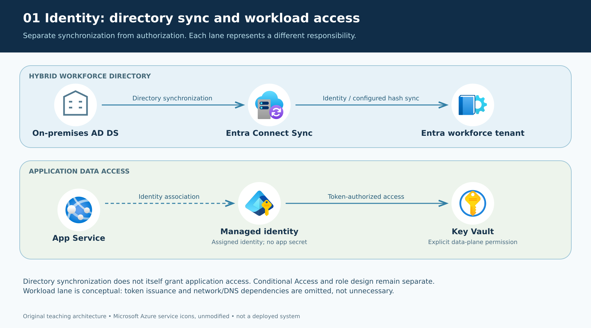
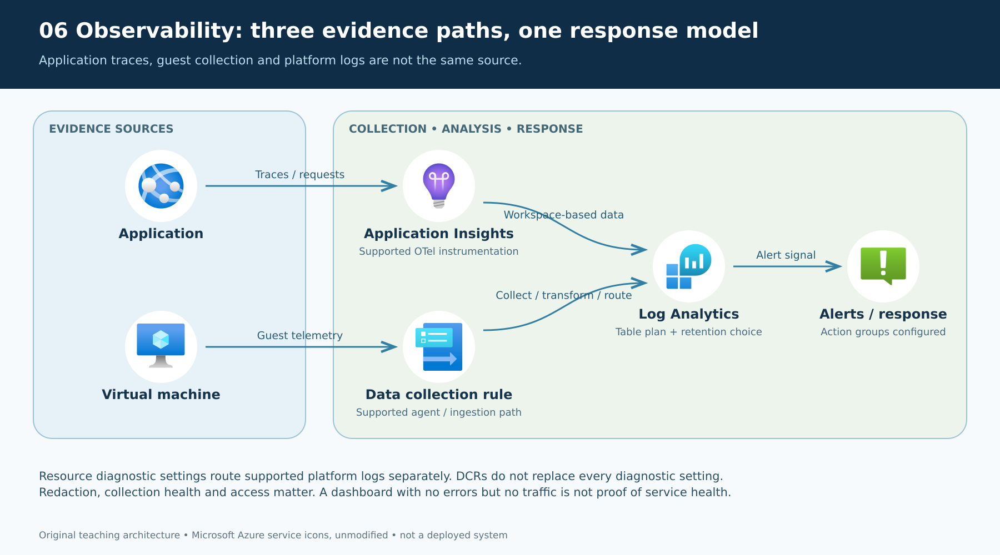
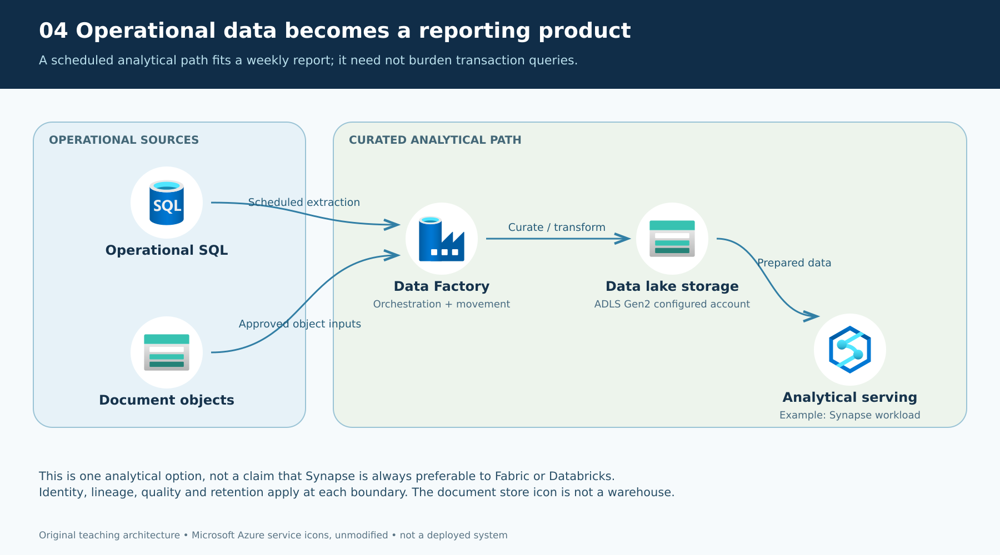
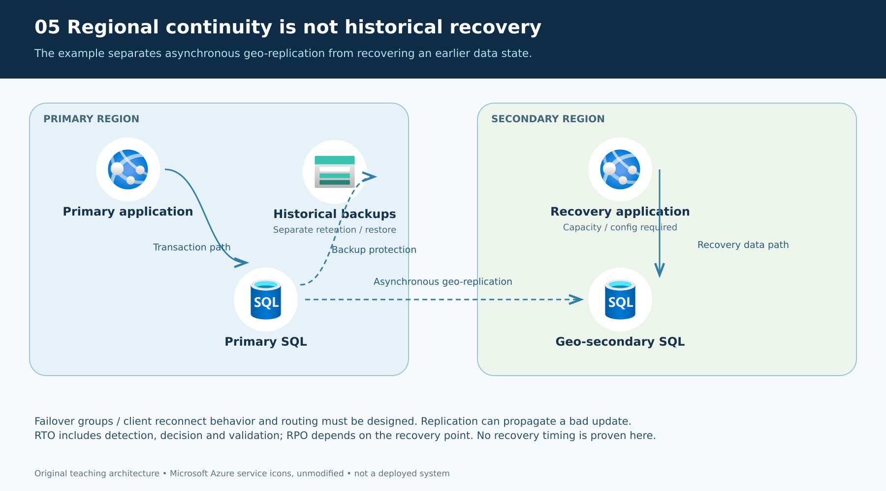
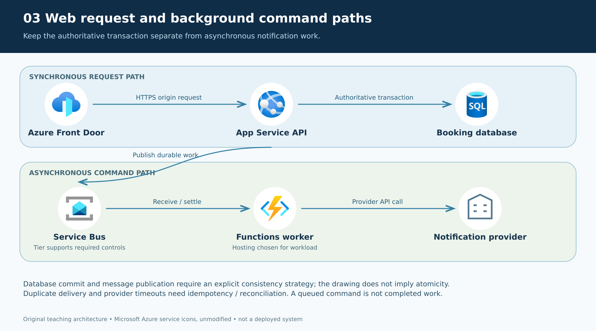
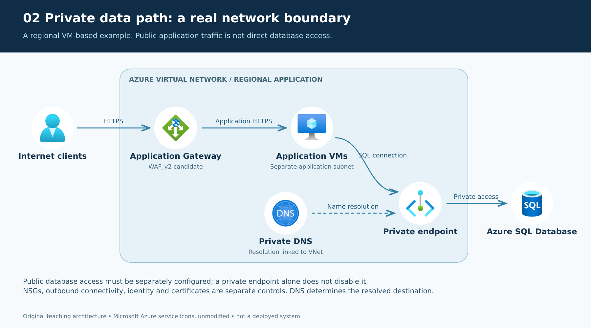

# AZ-305: Service, Plan and Architecture Decisions

Independent detailed course v0.3 · 15 November 2026

Original instruction with current Microsoft references and unmodified Azure service icons. No practice exams, labs or videos. Not Microsoft Official Curriculum.

# 00. Pilot: the exam and the architect’s job

**Learning purpose:** Understand the credential route, the scope of AZ-305 and how to reason about design before choosing a product.

## Course status and boundaries
This is an independently authored learning course, not Microsoft Official Curriculum and not an accredited training product. It explains architectural choices through original fictional examples. Public Microsoft documentation is the authority for product behavior. There are no exam dumps, practice-exam questions, videos or labs in this edition. Worked examples illustrate reasoning; they are not claims about actual examination content.

The verified study guide is the edition with skills measured from 17 April 2026. Its four weighted areas are identity, governance and monitoring (25–30%); data storage (20–25%); business continuity (15–20%); and infrastructure (30–35%). These weights guide study allocation, not a promise about a particular examination’s item distribution. [S01: AZ-305 study guide](https://learn.microsoft.com/en-us/credentials/certifications/resources/study-guides/az-305)

## Exam essentials
AZ-305 is Designing Microsoft Azure Infrastructure Solutions. Passing it alone does not award Azure Solutions Architect Expert: Microsoft also requires the Azure Administrator Associate certification. The published passing score is 700 on a scaled score, not a statement that 70% of questions must be correct. Price depends on the country or region in which the exam is proctored; check the booking flow rather than budgeting from a foreign-currency quotation. [S02: AZ-305 exam](https://learn.microsoft.com/en-us/credentials/certifications/exams/az-305/) [S03: Azure Solutions Architect Expert](https://learn.microsoft.com/en-us/credentials/certifications/azure-solutions-architect/) [S04: Exam scoring](https://learn.microsoft.com/en-us/credentials/certifications/exam-scoring-reports)

Do not plan around an asserted fixed question count. Microsoft’s generic role-based examination policy distinguishes 100-minute non-lab exams from 120-minute exams that may contain labs; booking time also includes other activities. The AZ-305 page does not settle which applies to a future appointment. Confirm the actual appointment, permitted aids, accommodations and local identification rules before scheduling. Course videos, labs and practice exams are excluded at the owner’s request; the pilot still explains the exam. [S05: Exam duration and experience](https://learn.microsoft.com/en-us/credentials/support/exam-duration-exam-experience)

## What an architect produces
An architect translates an ambiguous request into a defensible decision. “Make it fast and resilient” is not a measurable requirement. A useful design brief identifies the user journey, peak demand, acceptable latency, data sensitivity, recovery time, tolerated data loss, ownership and cost ceiling. A design decision then records the alternatives, the reason for the chosen option, its failure modes and the evidence that would invalidate it.

Azure Well-Architected Framework provides five lenses: reliability, security, cost optimization, operational excellence and performance efficiency. These lenses reveal tradeoffs. A second live region may improve continuity while increasing cost and reconciliation complexity. Cloud Adoption Framework complements workload design with organizational adoption and operating considerations. [S06: Azure Well-Architected Framework](https://learn.microsoft.com/en-us/azure/well-architected/)

## Worked example: Contoso appointment booking
Contoso’s fictional booking application serves clinics across two regions. The initial request is “always available.” The architect instead documents: booking writes must not be duplicated; viewing appointment availability can tolerate stale data; staff need a clear degraded-mode procedure; and an outage must have an accountable incident owner. This separates the availability of a screen from the correctness of a transaction.

The design is deliberately incomplete until stakeholders specify targets. Choosing a multi-region database before resolving conflicting-write behavior would conceal a business decision inside technology. The teaching point is to identify the missing requirement explicitly, not fill it with an invented service-level promise.

## Reading sequence
Start with identity and governance, then observability, storage, continuity, compute, integration, networking and migration. Revisit earlier decisions after later chapters: network isolation changes monitoring access; database recovery changes application behavior; deployment design changes rollback safety. Each chapter ends in a worked design note rather than an assessment.

## Examination logistics are part of readiness
Exam duration is the answering time; seat duration includes surrounding instructions and administrative activities. During applicable role-based exams, Microsoft provides restricted access to Microsoft Learn from the examination interface. This is not unrestricted internet access, access to personal notes or extra time. The examination interface and current policy govern which content is available. [S05: Exam duration and experience](https://learn.microsoft.com/en-us/credentials/support/exam-duration-exam-experience)

Prepare the correct booking account, required identification and testing environment, and request necessary accommodations through the official process before the appointment. A certification renewal assessment is distinct from taking AZ-305; Microsoft’s current role-based renewal route should be checked through the credential page. This course does not enroll the learner, purchase an exam or make an appointment. [S03: Azure Solutions Architect Expert](https://learn.microsoft.com/en-us/credentials/certifications/azure-solutions-architect/)

A score report indicates performance by area but does not disclose the exact items answered incorrectly. Use it as directional evidence rather than reverse-engineering a count of correct answers from a bar chart. The scaled score exists to account for differences in examination difficulty. [S04: Exam scoring](https://learn.microsoft.com/en-us/credentials/certifications/exam-scoring-reports)

---

# 01. Identity and authorization: separate the gates

**Learning purpose:** Distinguish identity proof, permission, privileged access and secret management across Azure and hybrid systems.

## Azure service architecture plate

Directory synchronization and workload authorization are separate responsibilities. The dashed association is conceptual, not a network hop. Original composition with unmodified Microsoft Azure service icons; not an official reference architecture.

## Select an identity architecture before selecting a licence

**Verification date: 15 November 2026.** This section is original instruction based on linked Microsoft documentation. The examples are fictional design decisions, not deployed configurations. Product packaging changes; licence eligibility and the rights of every benefiting user must be checked before purchase. A licence table is not a quotation or legal entitlement determination.

Three questions prevent a large category of identity mistakes. First, who is the actor: an employee, a partner, a customer, or software? Second, where is the authority for that identity? Third, what operation must that actor perform? An employee directory, a customer sign-up journey and a workload credential solve different problems. The fact that all three produce tokens does not make them interchangeable.

### Identity pattern selection

| Actor and requirement | Candidate pattern | Why it fits | Reject or reassess when |
|---|---|---|---|
| Employees use cloud applications | Workforce tenant and application integration | Central workforce lifecycle and access policy | The population is actually public customers with self-service registration |
| Partner needs a named internal application | External ID B2B collaboration | Partner authenticates using an appropriate external identity while access is controlled locally | Broad internal access is being granted merely to avoid application integration |
| Customers register for a public service | External ID customer identity in an external-tenant configuration | Separates customer journeys from workforce administration | The requirement is a handful of business guests collaborating internally |
| Azure-hosted code accesses an Entra-capable target | Managed identity | Removes an application-managed secret from the supported authentication path | The target cannot accept the resulting identity/token or its data permissions are undefined |

The workforce/customer distinction is documented in [External ID overview](https://learn.microsoft.com/en-us/entra/external-id/external-identities-overview). Managed identities still require target authorization; they are not universal access credentials. [Managed identities overview](https://learn.microsoft.com/en-us/entra/identity/managed-identities-azure-resources/overview).

**Worked decision:** Contoso has 600 employees, 40 contracted clinicians and 80,000 patients. The employees remain in the workforce model. Contractors receive sponsored, reviewed access to specified internal applications. Patients use a customer identity journey. Patient registration must never be interpreted as membership of a privileged workforce group. This is a concluded separation of populations, not a promise that a particular tenant configuration satisfies healthcare regulation.

### Entra licensing: distinguish base identity from additional capabilities

| Offering | Useful decision boundary | When it is insufficient |
|---|---|---|
| Entra ID Free | Basic directory/sign-in needs and supported security defaults | Custom Conditional Access is required |
| Entra ID P1 | Conditional Access and capabilities such as application proxy | Risk-based Conditional Access is required |
| Entra ID P2 | Risk-based identity protection scenarios beyond P1 | A requested newer governance capability is not included in the particular entitlement |
| Entra ID Governance | Advanced lifecycle, entitlement and review requirements under the documented prerequisite licence | It is being mistaken for a substitute for every P1/P2 or unrelated security feature |

P1 and P2 can be standalone or bundled. Governance has prerequisite and step-up arrangements, and some scenarios depend on separately licensed features. Do not infer licence rights from a portal control being visible. [Entra licensing](https://learn.microsoft.com/en-us/entra/fundamentals/licensing), [Governance licensing](https://learn.microsoft.com/en-us/entra/id-governance/licensing-fundamentals).

**Worked licence choice:** Contoso wants to require a compliant device or stronger authentication for sensitive workforce applications. P1 is the first entitlement category to evaluate because the requirement is Conditional Access, not merely the existence of MFA. If it additionally requires policies responding to assessed sign-in/user risk, P2 capabilities enter the evaluation. If it needs advanced joiner/mover/leaver automation, the team evaluates Governance rather than asserting that “P2 includes every governance feature.” The architecture names the needed capability; procurement then confirms the exact eligible offer and population.

For PIM, current Microsoft documentation requires Entra ID P2 or Entra ID Governance entitlements for the applicable users, including relevant eligible/time-bound role holders, approvers and reviewers. P1 alone is not the PIM entitlement. [PIM licensing requirements](https://learn.microsoft.com/en-us/entra/id-governance/licensing-fundamentals#privileged-identity-management).

The distinction matters economically. Buying the most expensive name for every identity can waste money, but buying only for administrators can also leave benefiting users incorrectly licensed. A solution architect should provide a capability-to-population matrix, not guess a tenant-wide licence quantity. Emergency access and exclusions must be intentional and monitored; they must not turn into a parallel unrestricted sign-in path.

### Hybrid authentication selection

| Method | What validates sign-in | Prefer when | Main architectural consequence |
|---|---|---|---|
| Password hash synchronization | Cloud authentication using synchronized password-derived data | Cloud independence from live on-premises validation is valuable and policy permits it | Synchronization health and lifecycle still matter |
| Pass-through authentication | On-premises validation through agents | A justified requirement demands that validation path | Agent and on-premises availability become sign-in dependencies |
| Federation | A separate identity provider | Required capabilities justify federation | More infrastructure and trust dependencies to operate |

Synchronization technology and authentication method are separate decisions. [Hybrid authentication guide](https://learn.microsoft.com/en-us/entra/identity/hybrid/connect/choose-ad-authn).

**Worked selection:** a branch loses its data-centre connection but staff must continue accessing cloud services. Cloud authentication is the preferred candidate when permitted; federation is rejected if its only justification is historical familiarity. If policy requires an on-premises validation path, the design cannot also claim independence from that path. It must show redundant validation infrastructure, connectivity and an accepted outage response. The correct architecture is the one that explains the conflict, not the one with the most identity products.

### Authorization and workload identity lifecycle

Azure RBAC expresses a principal, role and scope. Directory roles and Azure resource roles control different domains. An inherited broad assignment can make a narrow local assignment irrelevant as a safety argument. Management-plane rights and data-plane rights must be evaluated separately. [Azure RBAC overview](https://learn.microsoft.com/en-us/azure/role-based-access-control/overview).

| Workload identity choice | Good fit | Tradeoff to document |
|---|---|---|
| System-assigned | Identity should be tied to one resource lifecycle | Recreating that resource changes the identity and can require re-establishing permissions |
| User-assigned | Identity must survive resource replacement or be deliberately shared | Sharing enlarges the set of workloads capable of exercising its permissions |
| Application registration/service principal with separately managed credential | Integration cannot use a supported managed identity path | Credential custody, rotation and expiry become explicit responsibilities |

A managed identity removes one secret-management burden, not the need to design authorization. Contoso assigns its document processor only the data operations required on its document store. The deployment identity does not receive permanent application data access merely because it deploys the processor. Nevertheless, the operator able to replace the processor’s code may indirectly influence how its workload identity is used. The complete authority chain must therefore be reviewed.

### Key Vault tiers and Managed HSM

| Choice | Select for | Do not confuse with |
|---|---|---|
| Key Vault Standard | Secrets, certificates and software-protected key requirements | Dedicated HSM isolation |
| Key Vault Premium | Vault capabilities plus supported HSM-protected keys | A dedicated single-tenant HSM service |
| Managed HSM | Explicit dedicated cryptographic key custody/isolation requirements | A general secrets or certificate store |

Standard and Premium differ in key protection; Managed HSM is a separate dedicated service with its own authorization and recovery model. [Key Vault overview](https://learn.microsoft.com/en-us/azure/key-vault/general/overview), [Managed HSM overview](https://learn.microsoft.com/en-us/azure/key-vault/managed-hsm/overview).

**Worked selection:** Contoso needs application secrets and TLS certificate lifecycle management but has no dedicated-HSM requirement. A vault is the candidate; Managed HSM is rejected as unnecessary scope and cost. A separate signing-key use case with explicit dedicated custody requirements is assessed independently. Choosing Premium because a policy requires HSM-protected keys does not mean every stored secret becomes an HSM cryptographic key.

Rotation is a coordinated consumer change. A new key or secret version can be valid while an application still references an old version. The design states whether references are version-pinned, how consumers learn about rotation and how old versions are retired. Soft delete addresses recoverable deletion; purge protection restricts a later destructive stage. Recovering a vault does not automatically recreate all role assignments or event subscriptions. [Vault soft-delete and recovery](https://learn.microsoft.com/en-us/azure/key-vault/general/soft-delete-overview).

### On-premises application authorization: protocol and trust still matter

| Dependency | Candidate design | Important boundary |
|---|---|---|
| Supported on-premises web application needs remote workforce access | Entra application proxy with suitable preauthentication and SSO integration | It is not a universal tunnel for every application protocol |
| Legacy Azure-hosted application requires domain join, LDAP or Kerberos/NTLM | Evaluate Entra Domain Services against the required features | It is not identical to administering an unrestricted self-managed AD DS forest |
| Existing on-premises application enforces directory-group permissions | Preserve and deliberately map the required directory authorization model | A successful cloud sign-in does not automatically grant the correct application permission |

[Application proxy](https://learn.microsoft.com/en-us/entra/identity/app-proxy/overview-what-is-app-proxy) provides supported remote web access, with connector and SSO dependencies. [Entra Domain Services](https://learn.microsoft.com/en-us/entra/identity/domain-services/overview) supplies managed domain capabilities. These are separate product choices; a web-access requirement should not be solved by introducing an unnecessary managed domain, and a Kerberos-dependent service should not be described as fixed merely by adding a browser sign-in.

**Concluded hybrid case:** Contoso retains an internal web application whose authorization uses existing directory groups. It selects application proxy as the remote-access candidate, subject to the documented SSO compatibility, and retains explicit application group authorization. It does not grant all authenticated remote employees access. Connector availability, the on-premises application's directory dependency and the network route remain in the service recovery design. For a different application that needs domain-style protocols after moving to Azure, Domain Services enters a separate feature-compatibility decision. The two cases must not be conflated because their trust boundaries differ.

---

# 02. Governance: organize ownership before enforcement

**Learning purpose:** Design resource boundaries, compliance controls, tagging and identity governance without confusing their purposes.

## Build a governance model whose inheritance can be explained

A useful resource hierarchy is an argument about ownership and controls. Management groups apply governance above subscriptions, with inheritance into descendants. Subscriptions grouped together must trust the same Entra tenant. This is why a management group is not simply a folder for unrelated customers. [Management groups](https://learn.microsoft.com/en-us/azure/governance/management-groups/overview).

### Concrete hierarchy decision

| Scope in fictional Contoso | Purpose | Example control | Reason not to place it higher |
|---|---|---|---|
| Platform management group | Shared connectivity and operations subscriptions | Platform ownership and common audit requirements | Workload teams should not inherit platform administration |
| Regulated-workloads management group | Workloads with a shared jurisdiction policy | Approved-region restrictions | Marketing may legitimately use different regions |
| Clinical-production subscription | Production billing/access boundary | Restricted deployment roles | Development engineers do not need equivalent production rights |
| Clinical-development subscription | Safe development lifecycle | Budget and allowed-resource controls | Its disposable-resource assumptions must not govern production |
| Records resource group | Independently retained resources | Explicit retention ownership | Application replacement should not imply records deletion |

These are original design examples, not a prescribed Azure hierarchy. Their merit is that a reviewer can explain where a rule originates and which descendants it affects. A hierarchy that mirrors every reorganization may create churn without improving control. A single flat subscription may be simpler initially but can fail to express genuinely different ownership or isolation requirements.

A common anti-pattern is placing a restrictive policy at the root and creating a large collection of exceptions below it. Exceptions are sometimes necessary, but if nearly every workload needs one, the assignment boundary may be wrong. Another anti-pattern is putting an owner tag on a resource and treating it as permission. Metadata does not enforce access. Tags support cost allocation and discovery; authorization and policy remain separate mechanisms.

### Select the control from the intended effect

| Intent | Candidate control | What it does not prove |
|---|---|---|
| Decide who can perform an operation | RBAC | Resource properties satisfy organizational standards |
| Report a disallowed resource configuration | Audit policy | The configuration was corrected |
| Block a matching create/update request | Deny policy | Existing resources were repaired |
| Adjust supported properties | Modify effect with appropriate remediation design | Every property is modifiable or historical resources are already corrected |
| Add required related configuration | DeployIfNotExists with permissions and remediation | Assignment alone completed all historical deployment |
| Reduce accidental management deletion | CanNotDelete lock | Individual data objects are protected from deletion |
| Prevent applicable management changes | ReadOnly lock | Every data-plane operation is prohibited |

Effects differ by resource type and lifecycle; remediation requires its own identity and permissions. [Policy effects](https://learn.microsoft.com/en-us/azure/governance/policy/concepts/effect-basics). Locks constrain supported control-plane operations and can also interfere with normal management activities. [Resource locks](https://learn.microsoft.com/en-us/azure/azure-resource-manager/management/lock-resources).

**Worked decision:** Contoso wants supported resources to send diagnostic logs to an approved destination. The architect starts by discovering existing resource types and available categories. Audit establishes the initial compliance picture. A suitable deploy-if-not-exists policy can support configuration, but the remediation identity’s rights are deliberately scoped and the existing-resource remediation is separately tracked. Calling the policy assignment “monitoring complete” would be incorrect because data flow still needs evidence.

The architecture also evaluates an exception: a resource does not support the same diagnostic category. The response is not to force an imaginary setting. Record the unsupported requirement, alternative evidence and an owner for the residual gap. A technical limitation becomes a visible decision rather than a silent exclusion from the compliance denominator.

### Tag policy as an operating contract

A tag dictionary should state allowed values, accountable owner and handling of missing values. Consider `workload`, `environment`, `businessOwner` and `costCentre`, but use the organization’s actual reporting needs. A tag containing a personal name may become stale or expose information unnecessarily; a team identifier can be more stable. Sensitive information, secrets and access codes do not belong in tags.

Suppose a cost report excludes untagged resources. It may show excellent cost allocation precisely because it omitted the poorly governed resources. The report should show unallocated cost explicitly. If tags are inherited or appended through policy, clarify when that behavior occurs and what happens to pre-existing resources. Otherwise managers may believe changing a parent tag immediately changes every historical child resource.

### Identity governance as an evidence chain

Governance has three separate questions: should a person receive access, should they still retain it, and when should they activate privilege? Entitlement and approval processes address the first; access reviews address the second; privileged activation addresses the third. These processes depend on accurate sponsorship and resource ownership. A review sent to someone who cannot understand the resource is formally complete but operationally weak.

**Worked decision:** a supplier supports Contoso for three months. The design records the sponsor, permitted applications, expiry and reviewer. Privileged operations require an eligible assignment and a controlled activation path where supported. The supplier’s contract extension triggers a new access decision; it does not rely on someone remembering to remove a standing administrator role. The audit record shows the business justification without disclosing credentials.

### Governance rollout and reversibility

Governance changes should be treated as changes to a functioning operating system, not administrative housekeeping. A broad deny policy can prevent a recovery deployment. A ReadOnly lock can block an expected management operation. A tag remediation can affect billing reports. Before enforcement, identify affected scopes, exceptions, recovery procedures and evidence of impact.

The original teaching sequence is: describe intent, discover current state, choose a control, evaluate impact, obtain appropriate change authority, apply to a bounded scope, review results, then expand if justified. It is not an executable lab and it is not permission to change a tenant. Its purpose is to show why control rollout is part of architecture.

### What governance cannot settle by itself

A policy evaluating a region property does not prove every integrated service, backup and telemetry destination meets a residency obligation. A lock does not prove a document is recoverable. An access review does not prove that no alternate credential exists. A cost-center tag does not prove the invoice is correct. Strong design identifies the precise evidence each control produces and the separate review still required.

The final governance decision record contains the intent, scope, inheritance, control mechanism, remediation authority, exemption process, evidence date and owner. If any of those fields is absent, the organization may know which product was enabled without knowing what operational promise it makes.

---

# 03. Observability: design a useful evidence path

**Learning purpose:** Choose telemetry, routing, retention and alerts around service decisions rather than collecting everything.

## Azure service architecture plate

Application tracing and guest collection use different paths. Platform diagnostic settings remain separately configured. Original composition with unmodified Microsoft Azure service icons; not an official reference architecture.

## Design monitoring from the decision the responder must make

Contoso’s incident responders need to answer four different questions: did a platform component fail, did a management change occur, did an application request fail, and did the user’s business operation complete? No single chart answers all four. A monitoring design begins by specifying the evidence needed for each question and the identities allowed to see it.

### Collection and destination selection

| Evidence need | Candidate path | Architectural caution |
|---|---|---|
| Resource/platform logs and supported metrics | Diagnostic settings | Category support varies by resource |
| Management changes | Activity log and appropriate routing | A successful management operation is not application success |
| Application request/dependency behavior | Application instrumentation and Application Insights | Missing instrumentation can look like missing work |
| Supported agent/custom ingestion | Data collection rules | DCRs do not replace every diagnostic-setting scenario |
| Interactive investigation | Log Analytics | Choose access and table behavior, not only a workspace name |
| External event processing/SIEM integration | Supported Event Hubs routing | Downstream retention and consumers must be designed |
| Specific long-lived export requirement | Supported storage destination | Export is not automatically a complete searchable operations experience |

Diagnostic settings define collection and destinations for a resource’s supported data. [Diagnostic settings](https://learn.microsoft.com/en-us/azure/azure-monitor/data-collection/diagnostic-settings). Log Analytics stores tables and supports queries, access controls and retention choices. [Azure Monitor Logs](https://learn.microsoft.com/en-us/azure/azure-monitor/logs/data-platform-logs).

**Worked decision:** the booking API reports a 500 error after calling the payment provider. Platform CPU is normal. The proposed monitoring path correlates the request with dependency timing and a business correlation identifier. A management event records that configuration changed shortly before the failure. These are separate observations; the design does not automatically declare the configuration change causal. The responder needs enough evidence to distinguish provider failure, invalid configuration and application behavior.

### Table plans are not workspace-wide performance tiers

| Table plan | Prefer for | Tradeoff to evaluate |
|---|---|---|
| Analytics | Continuously used operational or detection data | Higher ingestion cost relative to cheaper plans |
| Basic | Supported tables used for troubleshooting and investigation | Query charging and feature restrictions |
| Auxiliary / Lake | Supported low-touch, verbose or retained data | Slower querying and restricted operational capabilities |

A workspace may contain different table plans. Support depends on the table; not every Azure table supports every plan. Switching to Auxiliary/Lake can stop alerts for that table. This is a capability decision, not merely a cheaper storage setting. [Table-plan configuration and limitations](https://learn.microsoft.com/en-us/azure/azure-monitor/logs/logs-table-plans).

**Worked selection:** Contoso’s current application failure events remain on an operationally suitable plan because responders depend on rapid correlation and alerting. Verbose debug data used only after a rare incident is evaluated for a lower-cost supported plan. Audit records have a separate retention requirement. Moving all three to the cheapest plan would confuse different purposes. The cost review therefore works table by table rather than applying one indiscriminate reduction.

### Retention has two different access states

Microsoft distinguishes analytics retention from long-term retention. Current documentation permits Analytics tables to extend analytics retention up to two years; Basic has a 30-day direct-query period, while Auxiliary can be queried through its total retention period under its query constraints. Total retention can extend to 12 years. Search jobs are relevant for older Analytics/Basic data. These are current platform capabilities, not a recommendation to retain everything that long. [Retention documentation](https://learn.microsoft.com/en-us/azure/azure-monitor/logs/data-retention-configure).

A recovery investigator’s need for a record and the ability to query it immediately are different requirements. If the policy says “retain one year,” ask whether the responder also needs interactive analysis of the entire year. Long-term retained data may satisfy preservation while failing an operational response-time expectation. Conversely, keeping rarely used data in an expensive interactive state may add cost without improving any decision.

### An illustrative ingestion calculation

Assume fictional telemetry volumes of 12 GB/day for operational events and 80 GB/day for debug logs. Before retention, indexing or export charges, 30 days represent 360 GB and 2,400 GB of ingestion respectively. These are teaching inputs, not a measured Azure workload or price quote. The debug stream dominates the volume, so reducing harmless duplication there can matter more than deleting critical operational events.

The calculation must not become “drop all large records.” Some low-frequency records are essential for security or recovery. For every filtered field, identify which investigation would lose evidence. For every duplicated destination, identify the independent retention or consumer purpose. Otherwise cost optimization can become evidence destruction disguised as efficiency.

### Alert design and action groups

An alert rule evaluates a signal; an action group routes the response. A notification arriving does not prove the incident was acknowledged or resolved. Select metric, log or management-event alerting based on the signal and supported features, then name the responder and response. [Azure Monitor alerts](https://learn.microsoft.com/en-us/azure/azure-monitor/alerts/alerts-overview).

| Situation | Useful alert reasoning | Avoid |
|---|---|---|
| Rising failed-booking rate | Measure user-impact signal over a defined window | Paging for every single transient exception |
| No expected telemetry | Treat collection silence as its own condition | Interpreting zero errors as health |
| Privileged configuration changed | Route relevant management-event evidence | Assuming all changes are malicious |
| Queue grows faster than workers drain it | Evaluate backlog age and downstream capacity | Scaling workers without checking the dependency bottleneck |

**Worked decision:** a ten-minute deployment window can legitimately increase some transient errors. The design records how maintenance context affects notification, without disabling evidence collection. After the window, persistent user failures still need detection. Suppression should have a time boundary and owner; otherwise a temporary quiet period becomes a permanent blind spot.

### Workspace and access architecture

A single workspace can simplify correlation, while separate workspaces can support operational or jurisdiction boundaries. Neither is universally correct. Start with who needs to investigate which resources and which data they are allowed to see. A centralized operations team may need a cross-workspace view while individual developers need narrower access. The workspace design should not force broad access to sensitive logs merely to diagnose one service.

Contoso therefore writes an access matrix before finalizing its workspace topology. Application responders need request/dependency telemetry for their workload. Security responders need designated security evidence. Finance needs summarized cost data, not raw user activity. The choice of central versus distributed workspace follows those requirements.

The completion criterion for a monitoring architecture is not “a dashboard exists.” It is that required evidence can be collected, retained, accessed and acted on by the intended people within the needed time. This is a design criterion; the course does not claim to have validated a live collection path.

---

# 04. Relational data: choose compatibility and operating responsibility

**Learning purpose:** Evaluate relational platforms, compute and service tiers, scaling, security and recovery as one design.

**Source verification:** 15 November 2026. These sections are independently written teaching material. Exact prices and region-specific SKU availability are deliberately not invented. Numerical examples are fictional inputs used to demonstrate decisions, not benchmark results. No practice examination, lab or video is included.

## 04.1 Separate the five decisions hidden in “choose a database”

A database recommendation is not complete when it names Azure SQL. It must answer five distinct questions: which engine and compatibility boundary; which deployment model; which performance and availability architecture; which compute consumption model; and which recovery design. A strong recommendation can be expressed as a sentence: “Use this engine on this managed deployment, in this tier with this compute allocation, because these measured needs require it; recover with these mechanisms.” This exposes assumptions that a product logo hides.

Begin with transaction correctness. Identify what must commit together, whether concurrent writes can conflict, and which reads can tolerate delay. Then record engine dependencies, typical and peak demand, working-set size, data growth, recovery targets and operator capability. Do not choose a database solely from data size. A small, latency-sensitive transaction workload can be harder to serve than a much larger archive. Conversely, a large database does not automatically need expensive transaction compute if it is seldom queried.

The distinction between a *hard constraint* and an *optimization preference* is important. A required unsupported extension can rule out a managed platform; a preference for an existing console should be weighed against the cost of running the underlying infrastructure. The design should name the exact constraint. “Legacy” is not a technical requirement, and “cloud native” is not evidence of fit.

## 04.2 Choose a deployment model before a tier

| Candidate | Select when | Reject or reassess when | Design obligation that remains |
|---|---|---|---|
| Azure SQL Database | The application fits a database-scoped managed SQL Server-engine service | Required instance/OS features are unsupported | Data access, query behavior, tier, recovery and application resiliency |
| Azure SQL Managed Instance | Instance-oriented SQL Server compatibility is valuable while keeping managed operation | OS-level access or a specific unsupported feature is mandatory | Compatibility validation, virtual-network design, capacity and instance lifecycle |
| SQL Server on an Azure VM | Engine/OS control or a required component makes managed placement unsuitable | The team cannot justify patching, backup and HA responsibilities | OS and SQL operations, disks, licensing, replicas and recovery |
| Azure Database for PostgreSQL | The application uses PostgreSQL and fits its supported managed capabilities | Required extension, privilege or version behavior is incompatible | Compute tier, connection behavior, maintenance, recovery and extensions |

This matrix is a selection aid, not a compatibility guarantee. The [Azure SQL deployment comparison](https://learn.microsoft.com/en-us/azure/azure-sql/azure-sql-iaas-vs-paas-what-is-overview?view=azuresql) distinguishes the SQL family’s control/responsibility boundaries. [PostgreSQL’s managed-service overview](https://learn.microsoft.com/en-us/azure/postgresql/overview) establishes the separate engine option. A PostgreSQL application should not be forced into a SQL Server-engine service simply because both are relational.

**Worked decision: a packaged payroll application.** Fictional Contoso discovers that the vendor requires an operating-system agent beside SQL Server. The agent cannot be removed and the vendor does not support the managed alternatives. SQL Server on a VM is therefore the selected candidate, despite the greater operating burden. The rejection of SQL Database is tied to a vendor-supported dependency, not nostalgia. The architecture assigns patching, backup and recovery ownership explicitly. If the vendor later supports a managed deployment, that becomes a review trigger rather than an obligation to keep the VM forever.

**Worked decision: a new PostgreSQL service.** A different Contoso team uses PostgreSQL-specific data types and a supported extension. Azure Database for PostgreSQL is the starting candidate because engine conversion provides no business benefit. A VM is not selected merely to imitate the existing development machine. The team verifies extension and privilege compatibility, then chooses the managed compute and availability configuration appropriate to production.

## 04.3 DTU and vCore are purchasing models, not application architectures

| Model | What it expresses | Useful fit | Potential mismatch |
|---|---|---|---|
| DTU | A bundled resource measure across compute and I/O characteristics | A team wants a compact purchasing abstraction for a suitable workload | Independent CPU/memory/storage reasoning or particular vCore-only options are required |
| vCore | Explicit compute allocation with related hardware, storage and service-tier choices | Migration sizing, workload-specific capacity choices and eligible licensing benefits | The team assumes a vCore alone predicts query latency |

DTU uses Basic, Standard and Premium service tiers, while the vCore model uses General Purpose, Business Critical and Hyperscale for SQL Database. Do not mix “Premium” in the DTU model with every Azure product that also has a Premium label. The names are product-specific. [DTU purchasing model](https://learn.microsoft.com/en-us/azure/azure-sql/database/service-tiers-dtu?view=azuresql), [SQL Database vCore model](https://learn.microsoft.com/en-us/azure/azure-sql/database/service-tiers-sql-database-vcore?view=azuresql).

A purchasing model is not a substitute for profiling. If an application is blocked by a poorly selective query, purchasing more resources may hide the problem temporarily. The architect separates query design, indexing, concurrency, connection management and service capacity. The capacity recommendation explains what is actually saturated. “Database slow” is not enough to distinguish CPU, storage latency, transaction-log pressure or lock contention.

## 04.4 Service tier changes the performance and recovery architecture

| SQL Database vCore tier | Architectural reason to consider it | When not to choose it automatically | Evidence required |
|---|---|---|---|
| General Purpose | Balanced managed relational workloads without a demonstrated need for a specialized architecture | The workload has proven I/O-latency or scale requirements beyond its fit | Representative latency and throughput at the selected capacity |
| Business Critical | Demanding transactional I/O and resilience needs justify local-storage/replica architecture | “Production” is the only reason offered | Value of lower latency and required availability relative to cost |
| Hyperscale | Large-scale storage/growth or its separated compute/storage architecture suits the workload | A small ordinary workload is assumed to become faster merely from the name | Compatibility, growth, replicas and recovery behavior for this architecture |

Tier choice affects more than maximum size. It changes storage/replica behavior and which features are available. Treat tier-specific documentation as the authority; do not transplant the SQL Database table into Managed Instance. The [vCore comparison](https://learn.microsoft.com/en-us/azure/azure-sql/database/service-tiers-sql-database-vcore?view=azuresql) describes these architectures.

**Worked decision: predictable transaction traffic.** Contoso’s fictional booking service has a steady daily load. General Purpose is the initial candidate because there is no evidence that a more specialized tier is necessary. The design defines the latency and concurrency it must satisfy. Business Critical becomes justified if representative evidence shows that its I/O/resilience characteristics solve a material requirement. It is not rejected forever; it is rejected as an unsupported first assumption.

**Worked decision: fast growth.** Another workload has a rapidly growing relational dataset and independent read-serving needs. Hyperscale enters the shortlist because the architecture may fit those requirements. The team records the behavior of replicas, restore and cross-region movement rather than assuming that all operations are independent of data size. A favorable headline capacity does not settle the end-to-end design.

## 04.5 Provisioned, serverless and pooled capacity answer different questions

| Choice | Select when | Avoid or qualify when | Cost behavior to model |
|---|---|---|---|
| Provisioned single database | Regular activity, predictable baseline and prompt response after idle periods matter | Capacity is idle for long intervals without a business need | Continuously provisioned compute plus storage/backup |
| Serverless single database | Intermittent demand and autoscaling fit, and warm-up/resume behavior is acceptable | The application cannot tolerate pause/resume effects or maintains constant activity | Actual/minimum compute behavior, storage, pause eligibility |
| Elastic pool | Many databases have noncoincident peaks and can share bounded resources | All tenants peak simultaneously or one tenant dominates | Pool capacity and per-database bounds, not simply database count |

Current SQL Database documentation describes serverless for General Purpose and Hyperscale, with configurable scaling ranges. General Purpose auto-pause/resume is available; Hyperscale auto-pause/resume is currently preview. Serverless is not supported in Business Critical or DTU. “Serverless” does not mean zero charges whenever the application sends no business requests: minimum compute, memory activity, pause eligibility and storage still matter. [Serverless compute](https://learn.microsoft.com/en-us/azure/azure-sql/database/serverless-tier-overview?view=azuresql).

Elastic pools share resources among databases on the same logical server. They are especially useful when low average use is accompanied by peaks occurring at different times; a pool is not infinite per-tenant capacity. Set bounds and analyze aggregate demand. [Elastic pools](https://learn.microsoft.com/en-us/azure/azure-sql/database/elastic-pool-overview?view=azuresql).

**Pool arithmetic, with fictional measurements.** Ten tenant databases each average 0.2 units and occasionally reach 2 units. Buying 2 units for every tenant reserves 20 units. If observed peaks rarely overlap, a smaller shared pool might be sufficient. But if a scheduled month-end job makes all ten peak together, the aggregate still reaches 20. An average of 2 across the group hides that event. The lesson is to model correlation, not merely multiply averages. These arbitrary units illustrate reasoning; they are not DTU-to-vCore conversion factors.

**Serverless decision.** A monthly administrative tool is inactive for long periods and its first user can tolerate a short start-up delay. Serverless is a reasonable candidate if the supported configuration can pause as intended. A public booking API with tight first-request latency receives a different recommendation, even if both databases have identical storage size.

## 04.6 Managed Instance has its own tier boundary

| Managed Instance option | Reason to shortlist | Important distinction |
|---|---|---|
| General Purpose | Balanced instance-oriented workloads | Managed Instance is not SQL Database with a different label |
| Next-gen General Purpose | Greater capacity or improved throughput/flexibility is needed within this family | Check supported hardware, availability and migration behavior |
| Business Critical | High I/O performance and replica-based resilience justify the cost | Read/HA characteristics do not remove application recovery design |

The current dedicated [Managed Instance service-tier table](https://learn.microsoft.com/en-us/azure/azure-sql/managed-instance/service-tiers-managed-instance-vcore?view=azuresql) lists General Purpose, its next-generation option and Business Critical. Do not infer that SQL Database Hyperscale is a Managed Instance tier from generic prose elsewhere on a page. Managed Instance compute is provisioned; applicable stop/start functionality is not equivalent to SQL Database serverless autoscaling.

A migration recommendation should preserve this product boundary. For example, if an application needs instance-level compatibility, first establish that Managed Instance supports it. Only then compare its tier choices. Selecting Hyperscale first and later discovering that the application needs a different deployment model reverses the decision order.

## 04.7 PostgreSQL compute choices require workload shape

| PostgreSQL tier | Best-fit starting point | Counterexample |
|---|---|---|
| Burstable | Intermittent, predominantly idle nonproduction work that fits its credit behavior | Sustained production load exhausting CPU credits |
| General Purpose | Balanced production CPU/memory requirements | A genuinely memory-dominated workload repeatedly missing its working set |
| Memory Optimized | A larger memory-per-vCore requirement is established | Paying for memory without evidence that memory pressure matters |

The current [PostgreSQL compute documentation](https://learn.microsoft.com/en-us/azure/postgresql/compute-storage/concepts-compute) describes a credit model for Burstable and explicitly discourages it for production. Do not recommend a burstable tier simply because the initial database is small. A small database can still receive sustained CPU-intensive work.

**Worked decision.** A fictional service performs continuous transaction processing throughout business hours. General Purpose is selected over Burstable because sustained demand, not stored size, determines the choice. If query evidence later shows a memory-constrained working set, Memory Optimized is evaluated. The team first checks query/index behavior to avoid turning an inefficient query into a permanent hardware expense.

## 04.8 Protection is a layered design, not a checkbox

A complete relational design records the workload principal, permitted operations, network path, encryption/key ownership, audit destination, backup policy and recovery operator. Those controls solve different threats. Network isolation does not prevent an authorized bad update; encryption does not prevent a compromised application from reading data it is allowed to read; backup completion does not prove an application can reconnect after restoration.

Consider a fictional customer-managed-key requirement. It introduces a key availability and recovery dependency. If the key is unavailable, restoring database bytes may not restore service. The design must therefore include key custody, rotation compatibility, authorization in the recovery environment and the consequences of revocation. If no custody requirement exists, adding customer-managed keys solely as a prestige feature may add operational risk without a demonstrated benefit.

The recommendation ends with an explicit boundary: the course explains the architecture; it has not created, priced, benchmarked or restored any database.

---

# 05. Documents, objects and integration: design for access patterns

**Learning purpose:** Choose semi-structured and unstructured storage and explain how operational data becomes analytical data.

## Azure service architecture plate

Operational inputs feed a curated analytical path. Synapse is one illustrated serving option, not a universal recommendation. Original composition with unmodified Microsoft Azure service icons; not an official reference architecture.

## 05.1 Cosmos DB is a workload choice before it is a throughput choice

Cosmos DB is a candidate when its supported data model, API, distribution and access behavior suit the application. It should not be selected merely because “NoSQL scales.” A design that needs many cross-entity joins and transactions with broad scope may fit a relational model more naturally. Conversely, a document model can fit aggregates that are usually read and updated together.

Define an aggregate as a business unit of change, not merely a convenient JSON object. If two records must always change atomically, explain whether their placement supports that requirement. If they can change independently, document how consumers handle temporarily different versions. Data-model decisions determine whether distribution simplifies the problem or moves complexity into application code.

## 05.2 Manual provisioned throughput, autoscale and serverless

| Capacity mode | Select when | Reject or qualify when | Architect must model |
|---|---|---|---|
| Manual provisioned throughput | Predictable demand makes a chosen RU/s allocation efficient | A fixed allocation wastes capacity during long low-demand periods | Required throughput, peak duration and scaling operations |
| Autoscale provisioned throughput | Demand varies and automatic adjustment within a configured range is useful | The team assumes it fixes a poor partition key or has no billing floor | Maximum setting, partition/region demand and billing behavior |
| Serverless | Intermittent activity and long idle periods fit a consumption model | Required capabilities or distribution exceed supported serverless constraints | Consumed RUs, storage and current account limitations |

Serverless bills consumed request units rather than reserved RU/s. Autoscale remains a provisioned-throughput model with configured bounds; it is not synonymous with serverless. Current documentation also describes dynamic scaling for nonuniform partition and region demand. [Serverless](https://learn.microsoft.com/en-us/azure/cosmos-db/serverless), [autoscale](https://learn.microsoft.com/en-us/azure/cosmos-db/provision-throughput-autoscale).

**Worked choice.** A rarely used internal approval application starts with serverless on the shortlist, subject to its supported capabilities. A globally active customer workload with unpredictable peaks selects autoscale provisioned throughput over serverless: serverless accounts support only one Azure region, so they cannot meet this fictional multi-region requirement. A high, stable stream may make manually provisioned capacity competitive. The architect does not declare a winner from traffic volume alone: required regional behavior and the actual cost of operations also matter.

## 05.2A Make throughput cost calculable

For manual provisioned throughput, model RU/s multiplied by billed hours and the applicable regional rate. For autoscale, model the billed high-water capacity within each billing interval, subject to current scaling behavior and applicable rates. For serverless, model consumed RUs plus storage. These are different units: RU/s is capacity; RU is work consumed. [Manual versus autoscale](https://learn.microsoft.com/en-us/azure/cosmos-db/how-to-choose-offer).

With a fictional autoscale maximum of 8,000 RU/s, the documented ordinary range is 800–8,000 RU/s. The lower bound is not zero. If a burst reaches the maximum briefly, billing is not calculated merely by averaging the entire hour's business requests. Dynamic partition/region scaling and multi-region write pricing can change the economic comparison, so the simple single-region comparison is not universal.

**Concluded choice:** for a workload that continuously uses nearly all of a stable allocation, manual provisioned capacity is the selected candidate. For irregular peaks that the business cannot schedule, autoscale is selected despite its different unit pricing. For infrequent activity confined to one region, serverless remains a candidate. The recommendation states the demand pattern, distribution requirement and cost unit together.

## 05.3 Partitioning constrains both efficiency and correctness

The partition key determines logical grouping and affects distribution, query routing and transaction scope. A large number of possible values can help distribution, but cardinality alone is insufficient if almost all requests target one value. Conversely, a random value can distribute writes while making the dominant query expensive. The [partitioning guide](https://learn.microsoft.com/en-us/azure/cosmos-db/partitioning) explains logical versus physical partition behavior; its ordinary logical-partition size boundary must not be generalized without considering the chosen partitioning features.

**Worked design: tenant-based records.** Contoso has thousands of small tenants and one very large tenant. A simple tenant identifier is convenient because most queries are tenant-scoped, but the large tenant may concentrate storage and demand. A hierarchical or more granular design may help only if it preserves the important query and transaction behavior. The architect compares the large tenant’s expected growth separately rather than hiding it inside average tenant statistics.

**Illustrative RU calculation.** Suppose a representative fictional read uses 4 RU and occurs 300 times per second. That operation class accounts for 1,200 RU/s. Add writes, queries, indexing effects and headroom; do not round the result into a production SKU without considering partitions. A query that scans many partitions can dominate cost even if most operations are cheap point reads. The operation charges in this example are invented teaching inputs, not documented fixed charges.

## 05.4 Consistency is visible to users

| Consistency option | What the application reasons about | Illustrative fit |
|---|---|---|
| Strong | Reads reflect the latest committed item state under the supported semantics | Freshness is mandatory and its latency/availability tradeoff is accepted |
| Bounded staleness | Staleness is bounded rather than arbitrary | A defined lag tolerance is part of the requirement |
| Session | Guarantees apply within a client session | A user expects to see their own update |
| Consistent prefix | Updates are not observed out of order | Ordered progression matters more than immediate freshness |
| Eventual | Replicas can temporarily diverge | A counter or catalog view tolerates delay |

These are not five performance SKUs. They are application-visible guarantees with tradeoffs. The chosen API and account settings matter. [Cosmos DB consistency](https://learn.microsoft.com/en-us/azure/cosmos-db/consistency-levels).

A fictional social counter can tolerate delay; allocating the final available seat cannot be justified by that same tolerance. A profile editor may need read-your-writes behavior but not globally linearizable access for every reader. The architect identifies the business consequence of stale data rather than choosing the strongest level by reflex. Stronger consistency can simplify some reasoning while increasing coordination costs; weaker consistency can improve some performance characteristics while moving responsibility into the application.

## 05.5 Object, file and analytical namespace are different interfaces

| Storage form | Primary reason to select | Poor reason to select |
|---|---|---|
| Blob Storage | Object/API access to binary assets and documents | Pretending it is a normal file share without adapting access |
| Azure Files | An application requires supported SMB or NFS file semantics | Using a file protocol solely because the developer knows drive letters |
| Data Lake Storage capabilities | Analytics benefits from hierarchical namespace and file/directory operations over object storage | Assuming enabling the feature creates a warehouse or analytics engine |

Azure Files planning includes protocol, media/performance tier, identity, networking, redundancy and management model. A share does not simultaneously provide both SMB and NFS semantics. The supported combinations differ; do not copy an SMB redundancy choice blindly to NFS. [Azure Files planning](https://learn.microsoft.com/en-us/azure/storage/files/storage-files-planning).

Data Lake Storage adds analytics-oriented capabilities to Blob Storage, notably hierarchical namespace. It is storage, not the processing engine. Permissions and namespace design should reflect the processing jobs and data ownership. [Data Lake Storage](https://learn.microsoft.com/en-us/azure/storage/blobs/data-lake-storage-introduction).

**Worked decision.** An unchanged legacy application expects a mounted file share and locking semantics, so Azure Files is the candidate. A new image service reads and writes objects by identifier, so Blob Storage is the candidate. An analytics team organizes partitioned datasets for processing, making Data Lake Storage capabilities relevant. The services are not ranked from basic to advanced; they satisfy different contracts. Azure Files does not support secondary-region reads through RA-GRS or RA-GZRS, so a Blob read-access design cannot simply be reused for a file share. [Azure Files redundancy](https://learn.microsoft.com/en-us/azure/storage/files/files-redundancy).

## 05.5A Azure Files: media, protocol and geography constrain the plan

| Requirement | Candidate direction | Eliminated assumption |
|---|---|---|
| Latency/IOPS-sensitive file access | Evaluate SSD file shares | Lowest capacity cost automatically wins |
| Cost-oriented SMB share with geographic replication | Evaluate supported HDD SMB plus GRS/GZRS | SSD automatically offers the same geographic options |
| NFS file semantics | Evaluate supported NFS configuration | The same share also serves SMB |
| Direct reads from a replicated secondary region | Azure Files does not provide RA-GRS/RA-GZRS behavior | A Blob-style secondary read endpoint exists |

The current [Files redundancy documentation](https://learn.microsoft.com/en-us/azure/storage/files/files-redundancy) restricts GRS/GZRS to HDD SMB shares; SSD shares use LRS or ZRS. A file workload needing both SSD characteristics and regional recovery therefore needs a separately designed supported recovery arrangement, not an impossible SKU combination.

**Concluded choice:** Contoso's ordinary departmental SMB share prioritizes cost and geographic protection over low-latency SSD behavior, so supported HDD SMB with geographic redundancy is selected. Its latency-sensitive Linux workload is evaluated separately with NFS/SSD and an explicit recovery design. Combining them into one universal share is rejected because their protocol and continuity requirements differ.

## 05.6 Access tier is a lifecycle decision

| Blob tier | Access behavior | Typical decision | Important cost/performance concern |
|---|---|---|---|
| Hot | Online | Frequently accessed or changing content | Storage cost versus lower access charges |
| Cool | Online | Less frequent access | Access charges and early-deletion economics |
| Cold | Online | Rare access that still needs prompt retrieval | Higher access cost tradeoff |
| Archive | Offline until rehydrated | Long retention with flexible retrieval time | Rehydration time and minimum-duration economics |
| Smart tier, where supported | Automatically adjusts among online tiers | Usage-based tier management is suitable | Current support and eligibility must be checked |

The current documentation lists minimum storage-duration economics of 30, 90 and 180 days for cool, cold and archive respectively, and distinguishes offline archive from online tiers. These tier choices apply to supported block blobs, not universally to every storage object. [Blob access tiers](https://learn.microsoft.com/en-us/azure/storage/blobs/access-tiers-overview).

**Worked choice.** Contoso has records retained for years but occasionally needed immediately for customer support. Archive is rejected for the immediately required subset even if its storage price is attractive. A separate subset whose retrieval can wait may use archive under an approved lifecycle policy. Archive supports LRS, GRS and RA-GRS, not ZRS, GZRS or RA-GZRS. A requirement for an archive tier therefore rules out those incompatible account combinations. “Old” and “rarely accessed” do not automatically mean “can wait hours.” The architecture splits those requirements rather than forcing one tier across the entire archive.

## 05.7 Redundancy and historical protection are independent

| Redundancy pattern | Failure boundary addressed | Does not establish |
|---|---|---|
| LRS | Multiple copies within a primary location | Zone or regional recovery |
| ZRS | Zone-level resilience within a supported region | Regional disaster recovery |
| GRS | Geographic replication in addition to primary local redundancy | Zero lag or writable active-active behavior |
| GZRS | Primary-zone resilience plus geographic replication | Historical recovery from a valid but mistaken update |
| Read-access variants | Supported reads from a secondary | Automatic write access to that secondary |

The [Storage redundancy guide](https://learn.microsoft.com/en-us/azure/storage/common/storage-redundancy) makes replication direction and secondary read access distinct choices. A service’s supported redundancy combinations still need checking. Replication can propagate unwanted changes, so retention and recovery features remain necessary.

**Worked incident.** A user accidentally replaces a valid document. Replication faithfully distributes the replacement. The correct response depends on a retained version or another supported recovery mechanism, not on having more identical copies of the new content. For a physical zone outage, the reasoning is different: historical versions alone do not provide an available serving endpoint. This is why protection design names the threat before choosing the mechanism.

## 05.8 Choose an analytical platform from processing and consumption

| Candidate | Strong reason to evaluate | Do not confuse it with |
|---|---|---|
| Fabric | Integrated analytics, engineering, warehouse and reporting experiences suit the operating model | A universal requirement for every Azure application |
| Azure Databricks | Engineering, lakehouse and data/AI workflows fit the team and requirements | A simple file store |
| Synapse SQL | Existing Synapse estate or a justified SQL analytical pattern | The transactional database’s replacement by default |
| Azure Data Explorer | High-volume telemetry/time-oriented analytical querying fits | A general transaction engine |
| Stream Analytics | Managed processing of event streams with suitable query patterns | Durable source-of-truth storage |
| Data Factory | Orchestration and movement between systems | The analytical serving database itself |

[Fabric](https://learn.microsoft.com/en-us/fabric/fundamentals/microsoft-fabric-overview), [Databricks](https://learn.microsoft.com/en-us/azure/databricks/introduction/), [Synapse SQL](https://learn.microsoft.com/en-us/azure/synapse-analytics/sql/overview-architecture), [Data Explorer](https://learn.microsoft.com/en-us/azure/data-explorer/data-explorer-overview), [Stream Analytics](https://learn.microsoft.com/en-us/azure/stream-analytics/stream-analytics-introduction).

Current Microsoft guidance points new warehouse evaluations toward Fabric, but that does not mean every existing Synapse workload should migrate immediately. The architect considers contractual constraints, existing skills, integration, economics and migration risk. A course must distinguish current vendor direction from an organization-specific decision.

For Synapse SQL, distinguish on-demand query behavior over data from dedicated analytical capacity. A dedicated resource can fit predictable heavy analytical workloads; querying data without provisioning that same capacity can fit other patterns. Avoid treating “serverless” across SQL Database, Synapse and Cosmos DB as one shared feature with identical semantics.

## 05.9 Data movement needs an execution location

Data Factory integration runtimes connect the orchestration definition to actual execution. Azure integration runtime, self-hosted integration runtime and Azure-SSIS integration runtime serve different needs, including cloud movement, network-accessible private/on-premises work and supported SSIS execution. The design selects runtime placement according to source access and processing requirements. [Integration runtime](https://learn.microsoft.com/en-us/azure/data-factory/concepts-integration-runtime).

**Worked pipeline.** Contoso imports nightly records from an on-premises source inaccessible from the public internet. A pipeline definition alone cannot reach it. The design identifies a supported execution location with the necessary network access, assigns an owner for its availability and protects its credentials. The copied data then lands in a raw zone, is validated and transformed, and is published to a curated reporting dataset. The transition from raw to curated is an explicit quality boundary, not a folder rename.

**Concluded analysis design.** Weekly utilization reporting accepts a 24-hour lag, so batch ingestion and a curated warehouse-style dataset are selected. A separate queue-surge signal requires prompt event processing, so a stream path is evaluated. Combining both into a continuously running complex streaming architecture is rejected because it does not improve the weekly business decision. Each path has a freshness contract, duplicate handling and an accountable owner.

---

# 06. Continuity: recovery objectives before redundancy

**Learning purpose:** Separate high availability, backup and disaster recovery, and explain end-to-end recovery across compute and data.

## Azure service architecture plate

Geo-replication addresses regional continuity; historical backup addresses recovery of earlier state. Neither alone proves end-to-end recovery. Original composition with unmodified Microsoft Azure service icons; not an official reference architecture.

## 06.1 First classify the failure

| Failure | Candidate mechanism | Why a different mechanism may be insufficient |
|---|---|---|
| Single node failure | Service-native local redundancy | A backup may restore eventually but not meet availability needs |
| Zone outage | Supported zone-redundant deployment | Two instances in the same failure domain may fail together |
| Region outage | Cross-region arrangement or geographic restore | Zone redundancy remains inside one region |
| Accidental valid update | Point-in-time/version recovery | Replication may copy the unwanted update |
| Key or identity dependency loss | Recovery of access and supporting dependencies | Healthy data bytes alone do not make the application usable |
| Application regression | Compatible release rollback or forward fix | Database failover does not repair incorrect application logic |

A continuity plan can use several mechanisms because the incidents differ. It should not claim that one product solves every failure. Recovery targets are business constraints; product capabilities are inputs into the design. The difference prevents an available database from being mistaken for an available user journey.

## 06.2 SQL Database local availability versus zone resilience

SQL Database provides managed local redundancy and servicing, while supported zone-redundant configurations address a larger failure boundary. Application connections can still experience interruptions and require appropriate transient-fault behavior. Zone redundancy is not the same as cross-region recovery. [SQL Database redundancy](https://learn.microsoft.com/en-us/azure/azure-sql/database/high-availability-sla-local-zone-redundancy?view=azuresql).

**Worked design.** Contoso’s booking service must continue through a zone failure. The design evaluates a supported zone-redundant database configuration and application placement, not merely two web instances. If the database remains within one zone, adding frontend instances does not satisfy the end-to-end requirement. If a region-wide event is in scope, a separate regional recovery design is required.

This also affects price comparison. A cheaper configuration that does not meet the failure-boundary requirement is not a competing solution on equal terms. Conversely, paying for cross-region complexity is not justified when the business explicitly accepts a longer regional restoration path and the costs outweigh the benefit.

## 06.3 PITR, LTR and geo-restore serve different purposes

| Mechanism | Best-fit recovery purpose | Required architectural reasoning |
|---|---|---|
| Point-in-time restore | Return to a selected recent historical state | Choose the cutoff and reconcile later legitimate writes |
| Long-term retention | Preserve selected backups for a longer business retention need | Retention governance, access and ongoing storage cost |
| Geo-restore | Rebuild from appropriately replicated backup after regional loss | Availability of backup, restore duration, new resource/access and traffic changes |
| Geo-replication/failover group | Maintain a secondary for regional continuity | Replication lag, failover decision, client behavior and dependencies |

[SQL backup documentation](https://learn.microsoft.com/en-us/azure/azure-sql/database/automated-backups-overview?view=azuresql) distinguishes retention and geo-recovery behavior. A configured backup schedule does not itself establish RTO. Restoring an earlier database state can create a new database and requires application integration decisions; it is not a magical in-place undo of one business transaction.

**Worked recovery.** An erroneous update starts at 10:20 and is discovered at 11:00. Restoring to 10:19 may remove legitimate work performed during the next 41 minutes. The technical restore point is only one input. The business owner must determine how to recover or replay legitimate work without replaying the error. The course does not invent an automated reconciliation capability that the application does not possess.

## 06.4 Failover groups simplify an endpoint, not the whole application

SQL Database failover groups coordinate databases across logical servers and provide listener endpoints that remain stable through geo-failover. Replication is asynchronous, so failure conditions and lag matter. The application still needs connection resilience, and identity/network/configuration dependencies must exist in the target environment. [Failover groups](https://learn.microsoft.com/en-us/azure/azure-sql/database/failover-group-sql-db?view=azuresql).

**Worked failure path.** Contoso’s database secondary is available, but its application in the recovery region lacks the correct workload permission. Database failover succeeds while the customer service remains unavailable. The corrected design treats permission, keys, configuration, DNS, application capacity and dependencies as part of the recovery unit. A successful database operation is evidence about the database operation, not proof of end-to-end recovery.

A deliberate failover decision also considers the former primary. If it returns, the team must prevent split ownership and reconcile state according to the service’s supported behavior. “Turn both on” is not a recovery strategy for a single-writer business system.

## 06.5 PostgreSQL availability is not the same as a read replica

PostgreSQL flexible server supports managed HA arrangements, including same-zone and zone-redundant patterns where available. Its HA standby supports availability; it should not be assumed to be the application’s read-scaling endpoint. Read replicas and regional recovery choices address different objectives. [PostgreSQL HA](https://learn.microsoft.com/en-us/azure/postgresql/high-availability/concepts-high-availability).

**Worked decision.** Contoso needs continuity through an infrastructure failure and also wants to isolate heavy reports. It cannot satisfy both requirements merely by writing “one replica.” It chooses the appropriate supported HA configuration for availability and separately evaluates a read or analytical path for reporting. The design records any freshness difference on the reporting path. Reporting performance must not be improved by reading from a component that is not intended to serve that purpose.

## 06.6 Cosmos DB: availability, consistency and backup remain separate

Cosmos DB for NoSQL supports zone and regional reliability options, with single-write or multi-write designs and backup choices. The client’s regional configuration and application consistency requirements affect recovery behavior. Multi-region capability does not mean every operation remains available with identical semantics under every failure. [Cosmos DB reliability](https://learn.microsoft.com/en-us/azure/reliability/reliability-cosmos-db).

**Worked choice.** Contoso’s public catalog can tolerate stale reads, so geographically distributed reading is useful. It retains a governed single-write approach because the team does not need concurrent regional edits. That simplifies conflict ownership but creates a write-continuity tradeoff during failover. A separate workload requiring active writes in multiple regions must define conflict behavior rather than copy this design unchanged.

A backup is still required for logical mistakes. Multiple regions can all contain the same mistaken change. Periodic or continuous backup capability must be selected and validated for the chosen account and API. This chapter explains the decision but does not claim every backup mode is available in every combination.

## 06.7 Blob recovery and retention controls

Blob protection can combine soft deletion, versioning, point-in-time recovery where supported, backup and immutability. Each protects a different event and has prerequisites or compatibility constraints. An immutable retention rule can deliberately prevent later deletion, so it needs governance rather than casual enablement. [Blob data protection](https://learn.microsoft.com/en-us/azure/storage/blobs/data-protection-overview).

**Worked policy.** Working documents need recovery from accidental replacement; final retained records need protection against alteration for an approved period. The team uses different lifecycle controls for those categories. It does not impose permanent immutability on every temporary upload, nor assume soft delete satisfies a legal hold. The decision records the owner of retention and the consequences of a mistake in the policy itself.

## 06.8 End-to-end RTO is a budget, not a service setting

Assume fictional requirements of a 30-minute RTO and five-minute RPO. The team allocates three minutes to detection, two to decision, ten to technical recovery, five to validation and five to traffic restoration. That totals 25 minutes and leaves five minutes of contingency. These are design allocations, not observed timings. If a required approval takes 20 minutes, the proposed plan fails before any database is restored.

The RPO must be tested independently. A successful 25-minute restoration using data from 15 minutes before the incident violates the five-minute loss tolerance. Conversely, zero lost data is not enough if service returns after the permitted outage. Confusing the two objectives can produce a design that appears resilient while failing the actual business commitment.

| Recovery stage | Evidence needed in a real operation | Common false conclusion |
|---|---|---|
| Detect | Correct incident scope and timeline | Any alert proves a disaster |
| Decide | Authorized strategy and recovery point | A technical operator chooses acceptable data loss alone |
| Recover | Supported operation completes for the intended resources | One component’s success means the service is restored |
| Validate | Identity, data and business behavior are acceptable | An open TCP connection proves correctness |
| Restore traffic | Intended clients reach the recovered service | DNS update means all clients moved instantly |
| Reconcile | Remaining writes and old-primary state are handled | Returning hardware can simply rejoin without review |

## 06.9 Cost and capacity in the recovery environment

A cold recovery pattern may reduce normal running cost but increase deployment and restoration time. A warm standby keeps some capacity prepared but may need to scale during an incident. An active-active pattern can improve certain availability characteristics while increasing coordination, conflict and cost complexity. The choice must include availability of capacity in the target region, not just a saved template.

**Worked comparison.** Contoso has one low-priority reporting service with a recovery tolerance measured in a day and a booking service with a 30-minute target. The reporting service can reasonably use a less expensive restoration strategy. Applying that strategy to booking solely to keep the architecture uniform would ignore the different business values. Equally, applying a costly always-active second region to every report would spend money without a corresponding requirement.

A recovery bill includes standby compute, replicated data, additional reads or writes, backups, networking and operations. No actual currency figure is asserted here because it depends on current region, SKU and quantities. A meaningful estimate must compare designs meeting the same recovery requirement.

## 06.10 Compute and hybrid recovery

Compute continuity requires three different designs: keep serving during a component failure, recover service after losing a location, and restore an earlier clean state. A healthy replacement VM does not recover a deleted database. Conversely, a retained backup does not route traffic or start dependent application tiers. Select the failure mechanism first, then the service. Current Microsoft guidance checked 15 November 2026 distinguishes Azure Backup's data protection from Site Recovery's replication and failover orchestration. [Azure Backup overview](https://learn.microsoft.com/en-us/azure/backup/backup-overview), [Site Recovery overview](https://learn.microsoft.com/en-us/azure/site-recovery/site-recovery-overview).

| Requirement | Select | Important boundary or rejected alternative |
|---|---|---|
| Survive host/rack faults for multiple VMs in one datacenter | Availability set with fault/update-domain distribution | Not protection against a complete zone or region failure; multiple application instances and traffic distribution are still necessary. |
| Continue serving after losing a zone | Application instances distributed across availability zones, with resilient load balancing and data | A single zonal VM is not a multi-zone application. Disk redundancy does not independently make its guest application highly available. |
| Manage and scale a repeatable VM fleet | Virtual Machine Scale Sets with deliberate zone placement and health/repair policies | Autoscaling is capacity management, not data replication; orchestration mode affects supported protection features. |
| Recover supported Azure or on-premises machines into another location | Azure Site Recovery | Replication can reproduce corruption. It does not replace retained backups or automatically repair application dependencies. |
| Recover older files, disks, machine state or supported application data | Azure Backup, with workload-appropriate protection | Restore latency and recovery-point frequency must fit objectives; backup alone is not an orchestrated hot standby. |

Availability sets and zones address different failure domains. A scale set can organize instances across zones, but the application must tolerate instance loss and retain enough surviving capacity. For example, three equal instances at 70% utilization cannot sustain unchanged load on two equal survivors without overload: total demand is 2.1 instance-equivalents, exceeding the remaining two. Provision headroom or accepted degradation, rather than assuming distribution guarantees performance. [VM availability options](https://learn.microsoft.com/en-us/azure/virtual-machines/availability).

For hybrid backup, the MARS agent protects supported Windows files, folders and system state; it is not a universal Linux or whole-datacenter protection agent. MABS or DPM provides a backup-server approach for supported workloads. Azure VM backup uses its VM protection integration. Select the application-aware method where transactional consistency is required, and distinguish recovering a complete VM from recovering individual application records. [Azure Backup architecture](https://learn.microsoft.com/en-us/azure/backup/backup-architecture).

### Managed compute changes responsibility, not recovery requirements

App Service zone redundancy currently uses supported Premium v2–v4 plans with at least two instances and a suitable regional scale unit. Two nonzonal workers are not equivalent. Regional continuity additionally needs a second deployment, traffic management, configuration and identity availability, and recovered dependencies. A deployment slot provides release isolation, not a second-region disaster-recovery site. [App Service reliability](https://learn.microsoft.com/en-us/azure/reliability/reliability-app-service).

Functions zone support depends on the hosting plan: classic Consumption does not support zones; Flex Consumption and Premium support zone-redundant deployments, while Dedicated follows supported App Service arrangements. Zone-resilient host storage is part of the design. For zone-redundant Flex Consumption, the platform maintains at least two billed always-ready instances per scaling function or group; this configuration cannot retain a scale-to-zero cost assumption. The resilience choice therefore changes the minimum running cost, not merely a checkbox. Retried queue work must be idempotent: a recovered worker can encounter a message whose side effect completed before acknowledgment failed. Do not promote a second regional consumer without considering duplicate processing and data ownership. [Functions reliability](https://learn.microsoft.com/en-us/azure/reliability/reliability-functions).

For Container Apps, replica distribution in a zone-redundant environment protects against zone loss; regional recovery still requires another environment, available images/configuration and an external-data recovery strategy. A new revision restores application code, not necessarily its database schema or persisted state. [Container Apps reliability](https://learn.microsoft.com/en-us/azure/reliability/reliability-azure-container-apps).

### Concluded hybrid VM decision

Fictional Contoso retains a supported on-premises VM application because its vendor requires guest-level installation. Its agreed objectives are a 60-minute site-outage RTO and 15-minute RPO, plus recovery of files deleted up to 30 days earlier. These are business requirements, not Microsoft guarantees. Select Site Recovery for the supported machines' site-failure path and a separate supported backup policy for historical recovery. Reject backup-only recovery because reconstructing the application stack after the outage is not a credible, unmeasured 60-minute plan. Reject replication-only protection because yesterday's deletion may already exist in the replica.

The recovery design pre-establishes Azure network, name resolution, identity connectivity, target capacity and licensing. Order recovery by dependencies: identity/name resolution, data services, application services, then ingress. A proposed budget allocates 10 minutes to decision-making, 20 to machine recovery, 15 to application/data validation and 15 to traffic restoration. These figures remain unproven until an authorized rehearsal measures them; replication lag must also demonstrate the RPO. A test failover uses an isolated network to avoid duplicate identities and unintended production transactions. After recovery, reprotection and failback require their own planned sequence rather than simply restarting the original machines. This selects the mechanisms while honestly withholding a claim of achieved recovery time. [Site Recovery overview](https://learn.microsoft.com/en-us/azure/site-recovery/site-recovery-overview).

## 06.11 What this section establishes and what remains unverified

This section provides concrete service and plan-selection reasoning, recovery mechanisms and original worked cases. It does not establish current eligibility for every region, maximum capacity for every SKU, a tenant’s licensing, exact prices or measured failover times. Those are changeable implementation facts. The linked primary documents were checked on 15 November 2026; product pages should be rechecked before a real decision.

No live resources, credentials, subscriptions or recovery operations were used. No laboratory, practice-examination or video content was added. These boundaries do not make the teaching generic: the tables state actual choices and the examples conclude decisions, while preserving the distinction between a defensible design and a validated deployment.

---

# 07. Compute: choose the responsibility you can operate

**Learning purpose:** Compare virtual machines, managed web hosting, containers, serverless and batch without treating modernization as an end in itself.

**Edition:** AZ-305 independent teaching expansion v0.3. Product documentation checked 15 November 2026. This chapter teaches choices, not a deployment procedure. All Contoso figures and decisions are fictional worked examples. No examination questions, labs or videos are included.

## 7.1 Choose the execution model before the price tier

Compute selection has two layers. First decide the operating model: virtual machine, managed web application, container platform, event-triggered function or scheduled parallel work. Then select the plan that supports the required features and capacity. Starting with “the cheapest tier” often produces a design that cannot provide its required network path, deployment method or operating-system capability.

Write a workload card with these fields: supported runtime; process lifetime; HTTP or event trigger; persistent state; custom image or OS requirement; expected demand shape; minimum acceptable responsiveness after idle time; inbound and outbound network requirements; required platform control; deployment frequency; and the team that will operate it. A blank field is a requirement to resolve, not permission to assume an unlimited platform.

| Workload constraint | Initial candidate | Why it fits | Reason to reject it |
|---|---|---|---|
| Supported web runtime, standard HTTP application, small platform team | App Service | Managed application hosting without cluster administration | Required OS customization or unsupported hosting feature |
| Containerized service, event-driven scaling, no Kubernetes API requirement | Container Apps | Application-oriented container execution | Essential cluster-level control unavailable in the managed abstraction |
| Kubernetes controllers, ecosystem or cluster-control requirement | AKS | Kubernetes operating model | Team cannot own the required operational responsibilities |
| OS agents, unusual dependencies, specialized licensed software | Virtual Machines | Broad machine-level control | Managed hosting meets requirements with less responsibility |
| Short event-driven work with compatible programming model | Functions | Trigger-focused execution | Required image, runtime or execution behavior unsupported by chosen host |
| Large collections of scheduled independent tasks | Batch | Pool and task scheduling | Work is really an always-on interactive service |

This is an original decision framework, not a Microsoft ranking of products. The right answer changes when the workload card changes. For example, putting a web application into a container does not create a Kubernetes requirement. Similarly, a familiar VM deployment does not prove that operating-system control is necessary.

## 7.2 App Service: distinguish the application from its plan

An App Service plan defines the compute on which its applications run. Applications in the same dedicated plan share that plan’s instances. Free and Shared use shared infrastructure with quotas; Basic through Premium use dedicated plan compute; Isolated v2 adds the App Service Environment isolation model. Tier availability depends on operating system and region. [Microsoft: App Service plans](https://learn.microsoft.com/en-us/azure/app-service/overview-hosting-plans)

| Plan family | Appropriate design intent | Reject or upgrade when |
|---|---|---|
| Free / Shared | Learning, evaluation and low-stakes development | Production capabilities, capacity or isolation are required |
| Basic | Simple dedicated hosting with modest requirements | The release design needs deployment slots or more advanced scale capabilities |
| Standard | Production web hosting requiring staging slots and a broader operational feature set | Required capacity or premium-only capabilities exceed the tier |
| Premium generations | More demanding capacity and supported advanced features | The requirement is actually full environment isolation rather than larger shared-platform hosting |
| Isolated v2 / ASE v3 | Dedicated isolated environment justified by explicit requirements | Ordinary managed hosting already meets the requirement at lower complexity |

### Current feature constraints that can decide the tier

The documented comparison includes Premium v4; Premium v3 is not the latest generation name. Selected current limits are below, not a replacement for the table’s footnotes. [Microsoft: App Service limits](https://learn.microsoft.com/en-us/azure/azure-resource-manager/management/azure-subscription-service-limits#azure-app-service-limits)

| Tier | Documented maximum scale-out | Staging slots per app |
|---|---:|---:|
| Basic | 3 instances | Not available |
| Standard | 10 instances | 5 |
| Premium v1 | 20 instances | 20 |
| Premium v2/v3/v4 | 30 instances | 20 |
| Isolated | 100 instances, more by request | 20 |

These are service limits, not evidence that a particular subscription can immediately allocate every size in every region. The selected SKU still needs capacity and compatibility verification. A requirement for six staging slots excludes Standard even if CPU demand is tiny; a requirement for two ordinary slots does not justify Premium by itself.

The distinction between Standard and Premium is not that one is “secure” and the other is not. Identify the feature, isolation, performance or scale requirement that drives the decision. Premium generations are not interchangeable in every region or operating system. A plan change also affects the other applications sharing that plan, so a small application can inherit the consequences of a large neighbor’s scaling decision.

Deployment slots are supported in Standard, Premium and Isolated tiers. They are live applications, not offline folders. Swaps move supported content and configuration between slots; some settings remain slot-specific. Slots consume resources from their plan. A slot swap does not reverse a database migration or external side effect. [Microsoft: deployment slots](https://learn.microsoft.com/en-us/azure/app-service/deploy-staging-slots)

**Worked choice:** Contoso has a small staff portal with a supported runtime, steady demand and a requirement to validate a candidate release before switching production traffic. Standard is the starting candidate because the slot requirement excludes Basic. The architect does not select Premium merely because the portal is important. Representative capacity evidence and any additional required feature decide whether Standard remains sufficient. Isolated is rejected because the organization has not specified a requirement for that environment model.

**Capacity reasoning:** suppose three applications share one plan. Their peaks occur simultaneously at the start of a working day. Adding their average CPU usage is misleading because their coincident peak matters. Moving one workload to a separate plan can be more useful than increasing every application’s shared resource pool. Conversely, unrelated low-demand applications can share capacity economically when isolation and simultaneous peaks are understood.

Scale-up changes plan capacity or features; scale-out changes instance count. A larger instance can help a memory-bound process, while more instances help only if requests and state can distribute correctly. Neither repairs a serialized application lock or a saturated downstream database automatically. [Microsoft: App Service scaling](https://learn.microsoft.com/en-us/azure/app-service/manage-scale-up)

## 7.3 Functions: the host changes the architecture

Current Microsoft guidance identifies Flex Consumption as the default starting point for new serverless function apps. Premium, Dedicated and Container Apps hosting support other scenarios; legacy Consumption has different operating-system and lifecycle constraints. Host selection affects scaling, network integration, available resources, containers and billing. [Microsoft: Functions hosting comparison](https://learn.microsoft.com/en-us/azure/azure-functions/functions-scale)

| Hosting candidate | Use when | Important rejection test |
|---|---|---|
| Flex Consumption | Variable compatible event-driven code; managed scaling and VNet connectivity needed | A custom container or unsupported runtime/OS is essential |
| Premium | Prewarmed capacity, supported container use or steady workloads justify it | Idle baseline cost outweighs required benefits |
| Dedicated App Service plan | Existing dedicated capacity or controlled instance allocation is appropriate | The design depends on automatic serverless economics it does not provide |
| Container Apps | Function programming model must run as a supported container alongside other services | Container packaging and environment model add no value |
| Legacy Consumption | Existing compatible application with a justified transition plan | It is chosen for a new application using assumptions copied from old guidance |

**Worked choice:** a document-notification handler receives a burst of work after uploads, then may be idle. It uses a supported runtime and does not need a custom image. Flex Consumption is the initial candidate. If a proprietary native library requires a custom Linux container, the decision changes: Premium or Container Apps hosting becomes relevant. Calling both designs “Azure Functions” does not settle the hosting question.

A function timeout setting is not a business durability guarantee. Even where a host permits long execution, process replacement, platform activity and dependency failure still matter. An HTTP caller also has its own timeout. Holding an HTTP request open while a long job finishes can be the wrong interaction even if the worker can continue running.

Durable Functions supplies stateful orchestration using orchestrator, activity and entity functions, with runtime-managed state and recovery. It is suitable for workflows requiring durable progress rather than one enormous in-memory function. It does not make an external payment, email or other side effect magically exactly-once. [Microsoft: Durable Functions](https://learn.microsoft.com/en-us/azure/durable-task/durable-functions/durable-functions-overview)

**Worked workflow:** Contoso receives a request, accepts it with a durable operation identifier, processes a document, waits for an external response and records the result. A restart must resume from durable progress, not lose the operation. The user sees pending, completed or failed status honestly. The design separates the orchestrator’s durable history from idempotency at the external side-effect boundary.

## 7.4 Container Apps: consumption and dedicated profiles

Container Apps offers Consumption and Dedicated models. Consumption suits demand-driven use, including scale-to-zero. Dedicated workload profiles provide dedicated capacity choices, including specialized hardware, and are billed at the profile-instance level rather than as an independent fixed machine per application. A workload-profiles environment can accommodate different needs. [Microsoft: Container Apps plans](https://learn.microsoft.com/en-us/azure/container-apps/plans)

| Candidate | Strong fit | Cost or design consequence |
|---|---|---|
| Consumption profile | Intermittent or variable services within supported resource requirements | Minimum replicas and active work determine how much scale-to-zero helps |
| Dedicated profile | Steady load, larger or specialized capacity, explicit compute isolation | Provisioned profile capacity can remain a cost even when an individual app is quiet |
| Container Apps job | Finite containerized work triggered manually, on schedule or by events | Completion, retry and timeout policy must be designed |
| AKS instead | Kubernetes-specific controllers or platform capabilities are essential | Cluster responsibilities become part of the workload’s operating cost |

A continuously running application and a finite job have different lifecycles. Container Apps jobs run work that ends, while applications typically serve continuing traffic or events. Jobs and apps share environment capabilities, but choosing a job does not establish its success criterion or make partial output safe. [Microsoft: Container Apps jobs](https://learn.microsoft.com/en-us/azure/container-apps/jobs)

**Worked choice:** a container receives HTTP traffic throughout the day while a nightly import runs for a finite period. Contoso uses an application for the HTTP service and evaluates a job for the import. It does not keep a permanently running container solely to sleep until midnight. For the import, completion means all intended records were reconciled, not merely that the container exited with a status code.

**Sizing consequence:** imagine two services each needing a large peak allocation but at different times. Shared dedicated profile capacity might be efficient if the peaks genuinely do not overlap. If both peak together, the aggregate requirement must fit. The illustration is about demand correlation, not a claim that every possible profile or scaling behavior is available in every region.

## 7.5 AKS: cluster tier is separate from worker capacity

AKS offers Free, Standard and Premium cluster-management tiers. Free has no financially backed uptime SLA; Standard targets production requiring uptime SLA coverage; Premium adds long-term support capabilities under its applicable support plan. Nodes, disks, networking and other resources still have costs. Current documentation also distinguishes Base and Automatic SKUs; Automatic is preconfigured with Standard cluster management. [Microsoft: AKS pricing tiers](https://learn.microsoft.com/en-us/azure/aks/free-standard-pricing-tiers)

| Tier | Choose for | Do not infer |
|---|---|---|
| Free | Development, evaluation or appropriate non-production use | Free worker machines or production uptime commitment |
| Standard | Production cluster management with required SLA coverage | The application itself has achieved its availability target |
| Premium | A justified long-term support requirement | Freedom to ignore application, node or security maintenance |

The cluster-management tier is only one dimension. Worker node family, pool layout, availability placement, pod resources, network design, upgrade policy and workload architecture remain independent decisions. A more expensive control plane cannot compensate for one replica of a stateful application with no recovery plan.

**Worked choice:** Contoso operates a platform that requires custom Kubernetes controllers and already has a capable platform team. Standard is the initial production tier; Premium is considered only if a documented supported-version lifecycle requirement calls for long-term support. The team separately sizes worker pools and allocates workloads. If that Kubernetes requirement disappeared, a managed application platform would return to the shortlist.

A cluster is also an organizational boundary. Several teams sharing a cluster may save infrastructure cost but create common upgrade schedules, operational dependencies and failure impact. Separate clusters can improve boundaries while increasing management effort. The architecture must explain which resources are shared, who owns their changes and how a failed rollout affects other tenants.

## 7.6 VM families and Batch: choose the bottleneck

Azure VM families emphasize different ratios and capabilities: general purpose, compute optimized, memory optimized, storage optimized, GPU and high-performance computing. Exact series determine processor architecture, temporary storage, disk and network behavior. Size names alone are insufficient: regional availability, quota and compatibility also matter. [Microsoft: VM sizes](https://learn.microsoft.com/en-us/azure/virtual-machines/sizes/overview)

| Evidence from workload | Family direction | Why a different family may lose |
|---|---|---|
| Balanced modest CPU and memory | General purpose | Specialized resources remain unused |
| High sustained CPU, modest memory | Compute optimized | Paying mainly for additional memory does not help |
| Large working set or memory pressure | Memory optimized | More CPU does not prevent paging |
| High local storage throughput requirement | Storage optimized | Network/disk limits dominate a compute-only choice |
| Supported accelerator computation | GPU | Unsupported application cannot exploit the accelerator |
| Tightly coupled scientific computation | HPC-capable candidate | Network and parallel-runtime constraints may dominate |

**Worked sizing:** a licensed legacy component is memory-bound at 24 GB while using little CPU. Contoso starts with a memory-oriented candidate rather than a large general-purpose size selected only by vCPU count. It checks the license’s core implications and storage/network limits before concluding that candidate is cheaper. The choice remains conditional on measurements, not an invented benchmark.

Batch manages pools of compute nodes and schedules jobs and tasks. It is appropriate for large parallel workloads where scheduling, pool lifecycle and task execution are central requirements. Application packages, input/output handling and task logic still need design. [Microsoft: Azure Batch](https://learn.microsoft.com/en-us/azure/batch/batch-technical-overview)

For a fictional 2,400 independent tasks at five worker-minutes each, the work is 12,000 worker-minutes. With 100 fully utilized workers the ideal lower bound is 120 minutes, before startup, transfer, skew and failures. Doubling workers can help only if input delivery and output storage can keep up. If the deadline is two hours, the ideal calculation alone already leaves no margin.

Spot or interruptible capacity can reduce cost when the work tolerates interruption, but lost progress changes the economics. A checkpointable simulation differs from a task whose entire six-hour result disappears on eviction. The design should compare total expected completion cost, not only the quoted rate of a single machine.

---

# 08. Application architecture: decouple without losing correctness

**Learning purpose:** Explain messaging, events, APIs, caching, configuration and deployment as connected design decisions.

## Azure service architecture plate

The transaction and notification paths are separate. A durable command is not proof of provider completion. Original composition with unmodified Microsoft Azure service icons; not an official reference architecture.

## 8.1 Establish message meaning before selecting a tier

A command asks another component to do work. An event announces a fact. A stream is a sequence of records intended for continuous ingestion and potentially independent replay. These meanings lead to different consumer behavior. A queue acknowledgement means something different from advancing a stream checkpoint, and neither should be confused with a human receiving an email.

| Requirement | Candidate direction | Why |
|---|---|---|
| Durable business work with explicit processing and failed-message handling | Service Bus | Brokered work distribution and enterprise messaging semantics |
| React to a resource or application event | Event Grid | Event routing to interested handlers |
| Ingest high-volume telemetry for independent consumers | Event Hubs | Partitioned stream and consumer progress model |
| Immediate answer required from a dependency | Synchronous API | Caller truly needs the result before continuing |

The table is an original interaction-selection model. It avoids the common error of calling all four “a queue.” An architect should also ask whether an asynchronous interaction changes the user contract. If the interface says “invoice created,” then accepting an invoice request into a queue is not yet enough evidence to display that statement.

## 8.2 Service Bus Basic, Standard and Premium

Basic supports queues. Standard adds capabilities including topics/subscriptions, sessions, transactions and duplicate detection on shared capacity. Premium uses dedicated messaging units and includes capabilities such as private networking and larger-message support. Tier selection therefore concerns both features and workload isolation. [Microsoft: Service Bus tiers](https://learn.microsoft.com/en-us/azure/service-bus-messaging/service-bus-premium-messaging)

| Tier | Use when | Reject when |
|---|---|---|
| Basic | Simple queue requirement fits its feature set | Topics, sessions or another unsupported capability is required |
| Standard | Rich brokered messaging fits shared-capacity behavior | Dedicated performance isolation or Premium networking is a hard requirement |
| Premium | Isolation, predictable capacity or Premium-specific capability justifies it | The workload has no requirement that benefits from the baseline capacity cost |

**Worked choice:** Contoso needs separate accounting and notification subscribers to react to a booking transaction, and it needs ordering within a business conversation. Standard is a candidate because Basic does not fit the required broker capabilities. If the namespace must use a supported private connectivity design requiring Premium, that requirement changes the tier decision even when message volume is small. A small workload does not automatically mean a low tier is technically sufficient.

Dead-letter handling needs an owner and business interpretation. A malformed invoice request should not loop forever. A dead-letter record may require correction and an explicitly controlled resubmission. Reprocessing can duplicate effects if the first processing attempt partly succeeded. The design must keep the original business identifier and distinguish “never attempted” from “outcome uncertain.”

Ordering also has a scope. Ordering within an identified conversation is different from global ordering across all business activity. Requiring global ordering unnecessarily can limit concurrency. Specify the actual business invariant: for example, changes to one appointment must be interpreted coherently, while unrelated appointments can proceed independently.

## 8.3 Event Grid Basic and Standard

Event Grid Basic focuses on push delivery from system, custom and partner topics or domains. Standard uses namespaces and supports MQTT, HTTP CloudEvents and flexible consumption including pull delivery. The two tiers differ in resource model and capabilities; Standard is not merely a larger quota setting for every Basic feature. [Microsoft: Event Grid tier choice](https://learn.microsoft.com/en-us/azure/event-grid/choose-right-tier)

| Requirement | Candidate | Design implication |
|---|---|---|
| React to supported Azure resource events through push handlers | Basic | Handler availability, retries and dead-letter strategy matter |
| MQTT publish/subscribe | Standard | Design client identity and topic permissions |
| HTTP consumers must control when they receive events | Standard | Pull-consumer lifecycle and acknowledgements matter |
| Existing Basic topic estate | Assess compatibility before migration | Do not assume every resource maps one-to-one |

**Worked choice:** a Blob-created event launches a thumbnail process. Basic is the initial event-routing candidate because the desired action follows an Azure resource event. A different connected-device application requiring MQTT directs the design toward Standard. Calling both “event-driven” does not make their protocol and resource requirements identical.

The thumbnail service still needs to tolerate duplicate or late notification. An event may be an indication to inspect the authoritative object, not an excuse to assume the payload contains every current property. If the object has changed again, the consumer needs a version-aware policy. Event routing does not resolve application concurrency automatically.

## 8.4 Event Hubs: tier, partitions and consumer progress

Basic is for simpler streaming needs; Standard adds broader production capabilities such as multiple consumers, Capture and Kafka support; Premium adds resource isolation and features such as customer-managed keys and dynamic partition scale-out; Dedicated supplies a single-tenant cluster for demanding scale. Feature support must be checked, especially geographic recovery versus data replication. [Microsoft: Event Hubs tiers](https://learn.microsoft.com/en-us/azure/event-hubs/compare-tiers)

| Tier direction | Typical decision trigger | Important caveat |
|---|---|---|
| Basic | Simple, limited stream consumption | Limited feature/consumer requirements must genuinely fit |
| Standard | Multiple analytical consumers and common streaming integrations | Shared capacity and quotas still constrain the design |
| Premium | Isolation, advanced security or partition growth requirement | More capacity does not repair a badly skewed partition key |
| Dedicated | Large workload requiring single-tenant cluster capacity | Dedicated infrastructure has a substantial cost commitment |

Standard throughput units constrain ingress and egress, while partitions determine how processing can be distributed. The documented unit provides up to 1 MB/s or 1,000 events/s ingress, whichever is reached first, and separate egress limits. Consumers share namespace capacity; partitions do not create unlimited bandwidth. [Microsoft: Event Hubs scalability](https://learn.microsoft.com/en-us/azure/event-hubs/event-hubs-scalability)

**Worked calculation:** a fictional stream produces 5,000 events per second at 100 bytes each. Raw payload is about 0.5 MB/s, yet the event-count dimension is more restrictive than that byte estimate. Protocol overhead, headroom and consumers still need consideration. Conversely, a small number of large events can hit a byte limit before an event-count limit. The architecture should show which constraint drove its capacity estimate.

A consumer checkpoint is a record of progress, not a transaction across all external effects. If a processor writes to a database and crashes before its checkpoint advances, replay may repeat the write. Idempotent or deduplicated processing remains necessary. Separate consumer groups allow independent progress; they do not automatically make every consumer’s downstream output consistent with every other consumer.

## 8.5 API Management: use the actual feature matrix

API Management classic and v2 tiers must not be treated as interchangeable. Developer is for non-production evaluation and lacks an SLA. Consumption emphasizes usage-based gateway operation but lacks several dedicated-tier features. Network injection, outbound private access, inbound private endpoints, multi-region and self-hosted gateway capabilities differ across tiers. [Microsoft: APIM feature comparison](https://learn.microsoft.com/en-us/azure/api-management/api-management-features)

| Requirement | Candidate direction to verify | Common wrong assumption |
|---|---|---|
| Non-production policy evaluation | Developer | Developer is a low-cost production tier |
| Simple usage-based gateway | Consumption | It includes every developer-portal/network capability |
| v2 dedicated gateway with modest requirements | Basic v2 | Private-backend access is identical to Standard v2 |
| v2 gateway reaching isolated backends | Standard v2 | Outbound integration equals full network injection |
| Classic production multi-region or self-hosted gateway requirement | Premium classic | Premium v2 automatically has classic feature parity |
| Full v2 virtual-network injection | Premium v2 | Outbound integration is equivalent to injection |
| v2 zone redundancy | Standard v2 or Premium v2 in supported regions | Zone support implies multiregion or full network injection |

**Documentation nuance checked 15 November 2026:** the current [APIM reliability guidance](https://learn.microsoft.com/en-us/azure/reliability/reliability-api-management) states that Standard v2 supports availability zones in supported regions, while the general feature matrix still shows otherwise. Treat zone redundancy separately from network injection and confirm the supported region and creation-time configuration in the [zone-enablement guidance](https://learn.microsoft.com/en-us/azure/api-management/enable-availability-zone-support). Do not use the older matrix alone to rule out Standard v2.

The v2 family is a distinct platform generation. Verify migration support and feature compatibility before treating an upgrade as an in-place change. The current v2 documentation is the relevant starting point for Basic v2, Standard v2 and Premium v2, rather than an old classic-tier diagram. [Microsoft: APIM v2](https://learn.microsoft.com/en-us/azure/api-management/v2-service-tiers-overview)

**Worked choice:** Contoso has public partner clients but an isolated backend. The architect first decides whether clients reach a public or private gateway, then separately decides how the gateway reaches the backend. Standard v2 may fit a supported outbound private-backend integration requirement. If the gateway itself must be injected into the virtual network, the shortlist changes. If multi-region within one classic service is essential, the current matrix points toward the appropriate classic capability rather than assuming Premium v2 supplies it.

An API gateway is not a replacement for business authorization. Validating a token establishes selected identity claims; the backend must still decide whether that caller can amend this appointment. A policy can enforce rate controls, transformations and other gateway behavior, but a poorly chosen policy can also break clients or expose data. Version policies with the API contract and test compatibility in an authorized engineering workflow outside this course.

## 8.6 Redis and configuration: capacity is not only memory

Azure Managed Redis offers Memory Optimized, Balanced, Compute Optimized and Flash Optimized families. These emphasize different memory/compute ratios or use flash for colder data. Flash is not a substitute for persistence or a stronger resilience guarantee. Feature availability and preview status vary by SKU; choose from the current table rather than transferring old Azure Cache for Redis tier names. [Microsoft: Managed Redis](https://learn.microsoft.com/en-us/azure/redis/overview)

| Workload evidence | Candidate family | Rejection reason |
|---|---|---|
| Large hot dataset, modest command rate | Memory Optimized | Compute/network demand actually dominates |
| Balanced ordinary workload | Balanced | A measured skew needs specialization |
| High command-processing demand | Compute Optimized | Extra compute adds little to a capacity-only problem |
| Large dataset with colder portion and acceptable access tradeoff | Flash Optimized | Predictable all-memory behavior or unsupported feature is essential |

**Worked choice:** Contoso’s catalog cache occupies substantial memory but performs relatively few operations. Memory Optimized is a candidate. A separate high-traffic leaderboard with smaller data but heavy command processing may favor Compute Optimized. Selecting solely by dataset size would miss this distinction. Neither selection is final without observing command mix, connections and network throughput.

A cache design must define source of truth, TTL, invalidation and degraded operation. Cache-aside loads missing entries from the authoritative store. A simultaneous expiry can generate a surge of source reads. The application should not fail catastrophically merely because an expendable cache is empty. For permissions or financial balances, the acceptable staleness may differ sharply from descriptive catalog content.

App Configuration manages settings and feature availability; Key Vault remains the appropriate place for secrets. Key Vault references can connect the two. A feature flag chooses behavior; a setting supplies a value; a secret grants or protects access. These are not the same lifecycle. [Microsoft: App Configuration purpose](https://learn.microsoft.com/en-us/azure/azure-app-configuration/overview), [Microsoft: App Configuration FAQ](https://learn.microsoft.com/en-us/azure/azure-app-configuration/faq)

| Configuration tier direction | Fit | What to verify |
|---|---|---|
| Free | Small evaluation | Request quotas and absence of production SLA |
| Developer | Non-production needs beyond Free | Throughput and unsupported production assumptions |
| Standard | Production configuration service | Quotas, replication and required features |
| Premium | Higher-scale production requirements | Actual throughput, storage and feature benefit |

**Worked consequence:** 100 application instances polling configuration on every user request can overload a configuration store that would comfortably serve a cached refresh design. Increasing the tier may hide inefficient consumption. The design specifies refresh behavior, last-known-good handling and the maximum acceptable time before a changed flag takes effect. A feature flag that disables booking must not remain stale indefinitely because a client silently stopped refreshing.

## 8.7 Deployment selection: artifact, infrastructure and data

A complete deployment design separates application artifacts, infrastructure definitions, configuration and data evolution. Rebuilding separately for each environment introduces a different artifact into each stage; promoting one identified artifact makes the relationship clearer. Environment-specific values must not be baked into the supposedly identical artifact. A deployment record should connect the source revision, build identity, configuration version and target.

| Rollout pattern | Use when | Main tradeoff |
|---|---|---|
| In-place replacement | Simple workload accepts the exposure and restart behavior | Less isolation between old and new |
| Slot or blue-green switch | Parallel candidate can be validated before traffic switch | Duplicate capacity and shared-data compatibility |
| Canary/progressive exposure | Health can be measured for a controlled subset | More routing and observation complexity |
| Feature flag | Code presence and behavior activation should be separated | Configuration becomes a release dependency |

This is an original deployment decision table, not a claim that every platform supports every pattern identically. App Service slots, Container Apps revisions and Kubernetes rollout mechanisms have different settings and rollback boundaries. Product-specific implementation must be checked after choosing the pattern. Infrastructure-as-code describes intended resources; it does not establish that a change is nondestructive.

**Worked release:** Contoso adds a nullable data field, deploys code that tolerates old and new records, enables the new behavior for a limited cohort, and only later removes obsolete dependencies. The sequence preserves compatibility. Reversing a code rollout after deleting a required database column would not be equivalent. The safe decision is to separate compatible expansion from destructive contraction, with evidence before each transition.

The course does not supply executable pipeline code because that would require repository, identity and environment decisions. It supplies the architectural specification: which identity may build, which may deploy, how authorization is bound to the change, what evidence permits promotion, what stops a rollout and which recovery action remains valid after new writes occur.

---

# 09. Networking: draw traffic intent and trust boundaries

**Learning purpose:** Select internet and hybrid connectivity, private access, performance controls and routing based on actual traffic.

## Azure service architecture plate

An example regional VM network uses Application Gateway and a private data endpoint. DNS and public-access settings remain explicit. Original composition with unmodified Microsoft Azure service icons; not an official reference architecture.

## Network selection starts with protocol, geography and trust

A service-selection table becomes meaningful only after the workload states what traffic actually does. Record whether it is HTTP, raw TCP or UDP; whether clients are global or regional; whether TLS terminates at an intermediary; whether the origin may be public; and whether DNS-level steering is acceptable. A requirement for “load balancing” alone is underspecified.

### Delivery and load-balancing decision table

| Service/tier | Prefer when | Reject or reassess when |
|---|---|---|
| Front Door Standard | Global HTTP delivery, caching and routing with supported custom WAF rules | Managed WAF rules or supported Private Link origin access is required |
| Front Door Premium | Those premium security/private-origin capabilities justify cost | A regional internal service needs no global HTTP edge |
| Application Gateway Standard_v2 | Regional application proxy/routing with v2 scaling capabilities | Web attack inspection is required from this gateway tier |
| Application Gateway WAF_v2 | Regional gateway plus WAF requirements | DNS-only steering or simple TCP/UDP distribution is the actual need |
| Standard Load Balancer | TCP/UDP distribution at the network layer | HTTP path routing, caching or WAF is required |
| Traffic Manager | DNS-based selection among public endpoints | A proxy must inspect every request or terminate TLS |

Front Door Premium supports managed WAF rules beyond Standard’s custom-rule capability; verify the exact supported private-origin type. [Front Door comparison](https://learn.microsoft.com/en-us/azure/frontdoor/front-door-cdn-comparison). Application Gateway v2 has Standard_v2 and WAF_v2 behavior plus other SKU distinctions; current documentation also describes TCP/TLS proxy capabilities, so “Application Gateway can only handle HTTP” is outdated. [Application Gateway v2](https://learn.microsoft.com/en-us/azure/application-gateway/overview-v2). Standard Load Balancer and Traffic Manager solve different layers. [Load Balancer SKUs](https://learn.microsoft.com/en-us/azure/load-balancer/skus), [Traffic Manager](https://learn.microsoft.com/en-us/azure/traffic-manager/traffic-manager-overview).

**Worked selection:** Contoso serves a public web application globally and requires managed WAF protection with a supported private origin. Front Door Premium is the candidate; Standard is rejected because the requirement includes premium capabilities. A regional application gateway may still be appropriate for a separate regional requirement, but adding it by habit creates another dependency and cost. A different internal TCP service uses a network-layer balancing candidate rather than being forced through the web edge.

Current lifecycle matters: Basic Load Balancer retired on 30 September 2025, and Application Gateway v1 retired on 28 April 2026. Do not recommend those legacy tiers for a new design. Front Door classic has its own retirement/migration timeline. A course should name current choices while retaining enough context to recognize legacy migration scenarios.

### Security services protect different locations and layers

| Control | Intended job | Not a replacement for |
|---|---|---|
| NSG | Allow/deny supported network flows at subnet/NIC-associated scopes | HTTP attack analysis or centralized application identity |
| Azure Firewall | Managed routed network/application filtering | Application business authorization |
| WAF | Inspect supported web requests for configured attack patterns | General TCP/UDP filtering or secure application design |
| DDoS protection | Mitigate supported traffic-flood availability threats | Fixing an exposed administrative interface |
| Private endpoint | Private access path to a supported service instance | Identity permissions or automatic removal of public access |

NSGs filter allowed and denied flows; the rule model is distinct from firewall inspection. [NSG overview](https://learn.microsoft.com/en-us/azure/virtual-network/network-security-groups-overview). Private Link supplies a private endpoint path for supported PaaS and service scenarios, but access policy and DNS still need design. [Private Link](https://learn.microsoft.com/en-us/azure/private-link/private-link-overview).

### Azure Firewall SKU choice

| SKU | Useful fit | Critical differentiator |
|---|---|---|
| Basic | Smaller environments needing the supported base filter set | Current published throughput ceiling is 250 Mbps; fewer enterprise features |
| Standard | Higher-throughput filtering with DNS proxy/custom DNS and enterprise features | Does not provide Premium TLS inspection/IDPS capability |
| Premium | Requirements include supported TLS inspection, IDPS or full URL filtering | More cost and inspection-policy complexity |

Published maximum throughput is not guaranteed application throughput. Basic’s threat-intelligence behavior differs from the higher tiers. Select the minimum tier meeting the actual requirements, then assess the traffic mix. [Firewall SKU comparison](https://learn.microsoft.com/en-us/azure/firewall/choose-firewall-sku).

**Worked decision:** Contoso’s branch integration needs DNS proxy and managed network filtering but has no approved TLS decryption requirement. Standard is the first candidate. Premium is not selected simply because the data is important; its additional capabilities require a relevant use case and operating design. If inspection of encrypted outbound traffic becomes an explicit requirement, Premium is evaluated with certificate trust, privacy and application-compatibility consequences. A pinned-certificate application may behave differently under interception, so this cannot be reduced to switching a tier label.

A firewall protects only traffic routed through it. In a hub-and-spoke layout, the architect shows the outbound path, return path and exceptions. A central firewall drawn next to a network does not prove that peer-to-peer flows use it. Asymmetric routing can create failures that are then misdiagnosed as an application outage.

### DDoS plan selection

| Plan | Candidate fit | Key distinction |
|---|---|---|
| IP Protection | A small number of eligible protected public IPs | Per-IP pricing; lacks Network Protection’s rapid-response and cost-protection benefits |
| Network Protection | Broader eligible IP estate and additional response/economic benefits | Plan-level economics and covered-resource eligibility must be evaluated |

Both provide supported L3/L4 mitigation capabilities. Not every PaaS resource or public-IP attachment is eligible; for example, current documentation excludes a public IP attached to NAT Gateway. Azure infrastructure protection is also distinct from these customer-configured plans. [DDoS tier comparison and limits](https://learn.microsoft.com/en-us/azure/ddos-protection/ddos-protection-sku-comparison).

**Worked decision:** the team inventories eligible public IPs and the required response model before choosing a plan. It does not multiply a per-IP rate by every resource icon on the architecture drawing. It also does not assume a DDoS plan secures the booking API against unauthorized transactions. Availability protection and business authorization remain different controls.

### Hybrid connectivity selection

| Choice | Prefer when | Main dependency/tradeoff |
|---|---|---|
| Site-to-site VPN | Encrypted connectivity over internet paths is suitable | Internet path and gateway capacity affect behavior |
| Point-to-site VPN | Individual clients need supported remote network access | Client authentication, device posture and routing must be governed |
| ExpressRoute | Private provider connectivity is justified by requirements | Provider, circuit, peering and gateway design; not automatic end-to-end encryption |
| VNet peering | Azure virtual networks need supported private connectivity | Not automatic transitive routing across every peer |
| NAT Gateway | Explicit outbound internet connectivity for supported subnet resources | No unsolicited inbound path; not an inspection firewall |

Multiple VPN tunnels share gateway capacity. [VPN Gateway](https://learn.microsoft.com/en-us/azure/vpn-gateway/vpn-gateway-about-vpngateways). ExpressRoute supplies provider-based private connectivity rather than a generic promise of encryption. [ExpressRoute](https://learn.microsoft.com/en-us/azure/expressroute/expressroute-introduction). Peering, routing and transit require deliberate configuration. [VNet peering](https://learn.microsoft.com/en-us/azure/virtual-network/virtual-network-peering-overview). NAT supplies outbound translation rather than content inspection. [NAT Gateway](https://learn.microsoft.com/en-us/azure/nat-gateway/nat-overview).

### Worked hybrid network with explicit tradeoffs

Contoso’s main office transfers large business datasets regularly, while two small branches only need occasional access. The main office evaluates ExpressRoute against recurring transfer and private-connectivity requirements. The branches evaluate VPN paths rather than automatically receiving equivalent dedicated connectivity. A backup path is not considered resilient until its capacity and independence are understood. Two paths using the same physical last mile may share a failure cause.

The hub contains shared network services. Workload spokes are not assumed to communicate transitively merely because each peers with the hub. The architect states which inter-spoke flows are allowed and what routes them. If inspection is mandatory, the design includes forward and return paths through the intended control. Administrative traffic is separated from public user traffic rather than hidden in a single arrow labelled “network.”

### Private DNS is part of the private endpoint design

Clients must resolve the service’s expected hostname to the appropriate private address through the intended DNS architecture. Private zones and forwarding differ between Azure and on-premises clients. The connection string should continue to use the service’s supported name; replacing it with an arbitrary private IP can break certificate or service behavior. [Private endpoint DNS](https://learn.microsoft.com/en-us/azure/private-link/private-endpoint-dns).

**Worked decision:** Contoso’s Azure worker resolves the database privately, but an on-premises reporting client still resolves its public name. The architecture is incomplete even if both can connect during a permissive configuration. The correction is a designed DNS/forwarding and service-access model, not a declaration that creating the endpoint made all traffic private. Public access settings and identity permissions must be evaluated independently.

### Performance reasoning and final traffic contract

Assume an illustrative 500-GB transfer must finish in four hours. Ignoring overhead, that needs roughly 278 megabits per second of sustained throughput using decimal units. An advertised 300-Mbps path leaves little margin for encryption, competing traffic, protocol overhead and storage bottlenecks. The example is arithmetic, not an Azure benchmark. The design should also ask whether the transfer can be incremental or scheduled so that bandwidth is not the only lever.

A final traffic contract lists source, destination, protocol, identity, path, inspection point, DNS dependency, expected peak demand and failure behavior. For the booking service, public HTTPS ends at the selected web edge; application-to-data traffic uses its approved private route; administrative access uses a separate controlled path; outbound provider access uses explicit egress. This written contract makes the architecture testable later without adding a lab or claiming live validation here.

## Edition limits and fact-check boundary

These tables deliberately do not quote prices or promise throughput under a specific application workload. Exact SKU capacities, region availability, subscription quotas, identity licence eligibility and tier migration restrictions require the linked current product tables. Where a table identifies a candidate, the worked narrative states why it fits and which assumptions could invalidate it. No live tenant was inspected and no resource was created. There are no practice exams, videos or labs in this material.

---

# 10. Migration: move a dependency system, not a server list

**Learning purpose:** Evaluate readiness and migration strategy for applications, databases and unstructured data with clear cutover criteria.

## 10.1 Discovery produces a dependency model

Azure Migrate provides discovery, assessment and migration capabilities across supported workloads. Its assessments help establish readiness, sizing and cost inputs, but the application owner must still validate compatibility and business behavior. A migration plan needs application dependencies, not just a machine inventory. [Microsoft: Azure Migrate](https://learn.microsoft.com/en-us/azure/migrate/migrate-services-overview?view=migrate)

| Workload finding | Migration direction | Additional decision |
|---|---|---|
| Required OS dependency cannot be removed within deadline | Rehost to suitable IaaS candidate | Patch, backup and operational ownership |
| Supported web runtime with manageable changes | Replatform to managed hosting | Deployment, filesystem and network differences |
| Business value justifies substantial change | Refactor selected boundaries | Transition coexistence and scope control |
| Application no longer provides value | Retire with authorization | Retention, dependencies and evidence preservation |
| Constraint prevents move | Retain for now | Supported hybrid path and review trigger |

**Worked dependency:** the booking service has a nightly file import, a database used by reporting and an on-premises identity dependency. Moving only the web server creates a hybrid system whether or not the project intended one. The design must decide which dependencies move in the same wave and which remain temporarily reachable. The temporary state has cost, latency, security and support consequences, so it deserves an architecture of its own.

Do not call rehosting a failure merely because it is less modern. A deadline or compatibility requirement may make it the correct first move. Equally, do not promise later modernization without an owner, trigger and measurable benefit. A migration is complete when the agreed service, data and operating outcomes are met, not when a VM first boots.

## 10.2 Database migration: supported pair first

Database Migration Service supports documented source-target migration combinations, including scenarios intended to reduce downtime. The correct path depends on engine, source version, destination, available mode and current tools. “Online” does not mean that no cutover or validation is needed. [Microsoft: Database Migration Service](https://learn.microsoft.com/en-us/azure/dms/dms-overview)

| Requirement | Approach to evaluate | Principal tradeoff |
|---|---|---|
| Downtime window permits complete transfer | Offline migration | Simpler transition but longer interruption |
| Short write interruption | Supported synchronization/online path | More setup, catch-up and reconciliation complexity |
| Engine-specific features must remain | Compatible managed service or VM candidate | More control may mean more operating responsibility |
| Cross-engine change | Explicit conversion project | Schema, query and semantic compatibility effort |

**Worked decision:** Contoso’s database is too large to copy within a 20-minute write pause. The architect evaluates a supported online synchronization path, followed by a controlled freeze and final catch-up. If the exact source-target combination does not support that path, the proposal is rejected or changed; the label “DMS” cannot solve an unsupported pairing. The evidence list includes compatibility findings, lag at cutover, row or business-total reconciliation and the application’s connection switch.

**What rollback means:** before the target accepts writes, the source may remain authoritative. After target writes begin, reverting the application to the source risks losing or duplicating those writes unless a reconciliation strategy exists. This boundary belongs in the approval and runbook. A backup taken before cutover preserves a state but does not automatically preserve all later transactions.

## 10.3 Files and objects: transfer tool versus migration service

Storage Mover is a managed service for supported migration scenarios, including on-premises file/folder and supported object sources. Evaluate its source/target and protocol support rather than assuming all metadata or ACL semantics map unchanged. [Microsoft: Storage Mover](https://learn.microsoft.com/en-us/azure/storage-mover/service-overview)

| Candidate | Best-fit reasoning | Reject or qualify when |
|---|---|---|
| Managed storage migration | Repeated large migration with orchestration and monitoring | Source/target combination or metadata behavior unsupported |
| Supported command-line transfer tool | Controlled copying with appropriate automation | Team needs migration management the tool does not provide |
| Data Box offline transfer | Network window cannot move bulk data efficiently | Shipping/custody/import delay conflicts with deadline |
| Application-level export/import | Semantics matter more than raw files | Export loses required history, permissions or relationships |

Data Box transfers data using a shipped physical device. It can make bulk movement feasible where network constraints are severe, but device availability, region, logistics and import time matter. A final-delta plan is still needed if the source changes while the device is in transit. [Microsoft: Data Box](https://learn.microsoft.com/en-us/azure/databox/data-box-overview)

**Worked arithmetic:** assume a fictional 20 TB archive and sustained 200 megabits per second available for transfer. Using decimal units, the ideal payload time is approximately 800,000 seconds, or 9.26 days, before overhead and interruptions. If the permitted network window is eight hours per day, elapsed time increases substantially. This calculation does not recommend an exact device; it shows why an offline option enters the shortlist.

A migration acceptance check must distinguish bytes, names, metadata, permissions and application behavior. Matching file counts can conceal missing content or incorrect access. Hash validation may support content integrity but does not prove that the target application interprets the data correctly. The plan names the evidence appropriate to each property rather than using one vague “verified” flag.

## 10.4 A complete fictional wave decision

Contoso must relocate a supported web application, its relational database and a document archive. The application depends on a scheduled import and a directory service. The deadline is fixed, but the business permits a limited write pause and a longer period of read-only access if announced. These are invented requirements for teaching, not a live project plan.

The architect selects managed web hosting if runtime compatibility is confirmed, a compatible database target with a supported low-downtime migration approach, and a managed archive-transfer path. The scheduled import moves in the same wave or is explicitly paused. The directory dependency remains temporarily hybrid under a documented supported connection. A wholesale refactor is rejected because it adds scope without being necessary to meet the relocation objective.

The wave has five distinct evidence states: readiness established; initial transfer completed; final synchronization within agreed bounds; target business behavior accepted; and old dependencies safely retired. None is inferred from another. For example, initial copy completion does not authorize source deletion. Old resources may remain temporarily for retention or recovery, with cost and access explicitly tracked.

The cost comparison includes duplicate operation during transition, transfer and storage charges, temporary network capacity and staff effort. A cheaper steady-state platform can still have a more expensive migration. Conversely, retaining an unsuitable platform to avoid short-term work may produce greater long-term cost. The architect makes the time horizon explicit so the comparison is not manipulated by choosing only one month of expense.

## Scope and verification limits for this expansion

This source adds concrete plan and service selection, not every SKU’s full limit table. It deliberately does not invent currency prices, benchmark results, quotas for an unspecified subscription or guarantees for an unspecified region. The linked pages were checked on 15 November 2026. Recheck fast-changing plans and features before a real design is approved, especially Functions hosting, AKS SKUs/support, APIM classic-versus-v2 networking, Redis preview sizes and regional availability.

All examples are original instructional scenarios. None was executed against Azure. There are no practice exams, laboratory procedures or video activities. Detailed database and data-storage design belongs to the companion data chapter; this expansion explains the compute, application and migration decisions that depend on it.

---

# 11. Synthesis: a defensible architecture decision

**Learning purpose:** Integrate the course into an original worked example without claiming a deployed or validated system.

## Architecture review: the fictional Contoso appointment service

This worked architecture is deliberately specific. All volumes, budgets and targets in this section are teaching assumptions, not measured facts, Azure guarantees or a recommendation to buy resources. Product compatibility must be checked in the service-selection chapters. The example shows how those comparisons become one coherent design rather than a shopping list.

### 1. Start with the decision brief

| Dimension | Fictional requirement | Consequence for the design |
|---|---|---|
| Users | Staff in one primary geography; public visitors can browse availability | Staff authorization and public delivery are different paths |
| Application | Supported managed web runtime; HTTP APIs; no OS driver or Kubernetes requirement | Begin with managed web hosting, not VMs or a cluster |
| Demand | 200 requests/second peak, 40 average during office hours; events concentrated after appointments | Size from representative requests and dependencies, not only average count |
| Transaction correctness | An appointment cannot be allocated twice | Authoritative write logic and concurrency control are mandatory |
| Documents | 2 TB initial uploaded content; 100 GB monthly growth | Object lifecycle and access controls need independent design |
| Reporting | Weekly utilization; at most 24-hour data delay | No justification for running every report on the transaction path |
| Recovery | 30-minute RTO; five-minute RPO, subject to business validation | Regional recovery and historical restoration require separate decisions |
| Team | Four application developers, shared operations support, no Kubernetes operations team | Operational complexity is a real constraint |
| Security | Separate staff/customer paths; minimal workload privileges; no secrets in source | Identity, deployment and application data access must be separated |
| Financial control | Budget approval required before purchasing; no amount supplied | Produce a cost model and choices, not a fabricated monthly quote |

A useful architectural discussion challenges the requirements before choosing products. For example, is the five-minute RPO acceptable for a newly booked appointment whose customer received confirmation? If not, the business requirement is internally inconsistent. A low RPO label cannot substitute for a policy governing lost confirmed transactions.

### 2. Make the primary service selections

| Concern | Selected candidate | Why this fits the fictional brief | Rejected alternative and reconsideration trigger |
|---|---|---|---|
| Web hosting | Azure App Service Standard as the initial plan | Supported web runtime, one staging slot and modest initial scale; no zone-redundancy or isolated-environment requirement is assumed | AKS adds cluster responsibility without a Kubernetes requirement; revisit for a demonstrated platform need |
| Booking records | Azure SQL Database General Purpose, provisioned compute, as the initial tier | Relational transactions fit allocation; steady traffic argues against pause/resume, and no specialized I/O requirement is assumed | Cosmos DB is not selected merely for global distribution; revisit only with a documented alternative correctness model |
| Uploaded documents | Blob Storage, hot access tier and ZRS for the active document set | Frequent online retrieval and zone resilience; historical versions and regional recovery remain separate decisions | Database blobs would couple document storage and backup growth to transaction infrastructure |
| Notification work | Service Bus Standard for the initial command path | Queues with required session-based ordering/duplicate controls; Premium is not selected without isolation or capacity need | Event Hubs is a stream abstraction, not the default command-processing choice |
| Credentials | Managed identity where supported; Key Vault Standard for unavoidable secrets | Reduces application-owned credential handling while retaining explicit permission design | A shared administrator credential is rejected regardless of convenience |
| Telemetry | Application Insights and Log Analytics Analytics tables for operational queries/alerts | Connects user requests with dependencies and infrastructure changes | CPU-only monitoring cannot establish booking success |
| Reporting | Scheduled Data Factory ingestion into a warehouse-style serving dataset | Separates tolerant reporting from latency-sensitive transactions | Immediate stream processing is not purchased for a weekly report without another requirement |

The initial tiers are explicit and conditional on the stated fictional brief. Standard web hosting is not being declared sufficient for every 200-request/second workload: representative capacity evidence must confirm it. If zone redundancy becomes mandatory, the web plan choice changes to a currently supported zone-capable configuration. Likewise, storage ZRS does not by itself satisfy regional recovery. This table records an architectural starting decision and its revision triggers, not a deployment approval or a benchmark claim.

### 3. Turn service choice into plan choice

For the web tier, identify whether the design needs deployment slots, autoscaling, zone resilience, private connectivity or dedicated isolation. Compare these requirements with the current plan capabilities. Reject a low-cost plan if it lacks a required capability; reject an expensive plan if the capability has no requirement behind it. Keep application instance count distinct from the maximum allowed by a plan.

For the database, distinguish engine compatibility, service tier, compute model and resource capacity. A variable workload may benefit from a supported serverless option, but a steady workload or strict responsiveness expectation may favor provisioned capacity. Business Critical or Hyperscale must solve a specific latency, resilience or scaling requirement rather than serve as a generic “production” label. A pooled design is justified by multiple databases with complementary demand, not by one database.

For messaging, map required sessions, duplicate detection, transaction behavior, isolation and capacity to the service’s actual tier. If the application design requires a feature unavailable in the cheaper tier, either change the tier or change the design explicitly. Do not leave a feature-to-tier incompatibility for implementation to discover.

Each selection becomes a short decision record: required feature, chosen plan, relevant official source, supported region, capacity assumption, rejected option and review trigger. The recorded source date matters because product plans evolve.

### 4. Define the actual traffic and trust paths

| Source | Destination | Intent | Identity or control | Not permitted by this statement |
|---|---|---|---|---|
| Public visitor | Public application endpoint | Browse and begin an approved customer journey | Edge/application controls and application authorization | Direct database or administration access |
| Staff client | Staff application functions | Perform role-permitted appointment work | Workforce authentication and business authorization | Implicit permission to administer Azure |
| Web workload | Booking database | Required transaction operations | Narrow workload data permissions and approved network path | Subscription-wide management authority |
| Web workload | Document store | Scoped object operations | Appropriate identity/data role and object authorization | Public anonymous access to uploaded documents |
| Worker | Messaging service | Receive and settle its work | Queue/topic-scoped authorization where supported | Unrelated queue administration |
| Worker | Notification provider | Approved outbound delivery | Separate provider credential if unavoidable; controlled egress | Arbitrary external destinations |
| Application | Telemetry destination | Redacted operational evidence | Supported ingestion mechanism and access controls | Recording tokens or sensitive document bodies |
| Deployment identity | Deployment target | Release an approved artifact | Environment-scoped deployment authority | Routine use as the application’s runtime identity |

This is a conceptual allow-intent table, not a deployed firewall policy. Each row needs protocol, endpoint and supported control details in an implementation design. Some paths use Azure service integrations rather than a simple TCP allow rule. DNS, token acquisition and service dependencies must not disappear merely because the diagram omits them.

### 5. Follow one booking through the architecture

A visitor sees availability that may be briefly cached. The application treats it as a view, not a reservation. When the visitor submits a booking, authoritative transaction logic checks the current state and either commits the booking or returns a truthful conflict. The response distinguishes accepted, completed and failed work.

The notification is separate. A committed booking can enqueue work, but the design must handle the boundary between committing the booking and publishing the message. A robust implementation needs an explicit consistency strategy for that boundary rather than assuming two systems commit atomically. The worker handles repeated delivery using a durable business identifier and idempotent behavior. A provider timeout leaves an uncertain delivery result; the application does not assert that the recipient definitely received the message.

Uploaded documents use separate authorization and retention. A document identifier in the booking record is not itself a permission to download the document. Reports consume curated data without needing unrestricted operational access. These distinctions are why the design cannot be reduced to “frontend, API, database.”

### 6. Quantify capacity without pretending to have a benchmark

Suppose a representative fictional request consumes 20 milliseconds of CPU time. At 200 requests/second, the theoretical CPU work is four CPU-seconds per wall-clock second. That arithmetic is not a VM or App Service sizing recommendation: concurrency, garbage collection, network waits, per-instance limits and required spare capacity still matter. If the representative work is wrong, the estimate is wrong.

Likewise, 100 GB monthly document growth produces 1.2 TB annual new logical data before versions, backups, replication and retention expiry. Storing two versions on average is not necessarily exactly twice the invoice because operations and tier behavior also matter. The calculation identifies cost drivers to price, rather than inventing a total.

A recovery plan allocating three minutes to detection, two to decision, ten to restoration, five to validation and five to traffic return totals 25 minutes. Its five-minute contingency disappears if identity recovery takes longer than assumed. A technically fast failover is not sufficient if the human decision is not defined.

### 7. Compare three failure stories

| Failure | Useful mechanism | Mechanism that is insufficient alone | Business acceptance criterion |
|---|---|---|---|
| One application instance fails | Multiple healthy instances and suitable traffic handling | A backup of application code | Requests continue within the agreed degraded behavior |
| Primary region is unavailable | Coordinated application/data recovery and routing | Database backup completion notification | Required user journeys work and data-loss tolerance is met |
| Erroneous data update replicates | Historical recovery and reconciliation | A second region with the same bad update | Restored state is correct and legitimate subsequent work is handled |
| Key or identity access is lost | Protected key recovery plus permission/integration reconstruction | Healthy web servers | Application can access only its intended dependencies again |
| Notification provider times out | Observable uncertain state and controlled reconciliation | Blind unlimited retries | No false completion claim and no uncontrolled duplicate side effect |

The design uses different mechanisms because these failures differ. Saying “high availability enabled” cannot settle all five.

### 8. Show the financial tradeoff honestly

The cost model has at least eight lines: web compute, database compute/storage, object storage and operations, messaging, observability, networking/egress, resilience capacity and identity/security licensing. It distinguishes steady baseline from usage-sensitive cost. A secondary-region warm environment may shorten recovery while adding ongoing cost; a colder design may save steady cost while making recovery time less predictable.

The architect presents alternatives with the same workload assumptions and notes what each excludes. Prices must be checked for the actual region, currency, plan and commercial arrangement. A monthly estimate without assumptions about retention, traffic and replicas is not decision-grade evidence.

### 9. State the conclusion and what remains unresolved

For this fictional brief, choose a managed application and relational core with separate object storage and durable background work, not a Kubernetes platform or a globally writable document database by default. Keep the reporting path tolerant and separate. Adopt identity-scoped access and observability that follows business requests. Select exact plans from documented capability requirements rather than brand familiarity.

The design still requires current region/SKU confirmation, representative performance evidence, a priced capacity model and authorized operational validation before real deployment. Those are implementation needs, not claims that this course includes labs. The completed teaching outcome is a defensible, connected set of service and plan choices with visible tradeoffs, not an assertion that the service is already live.