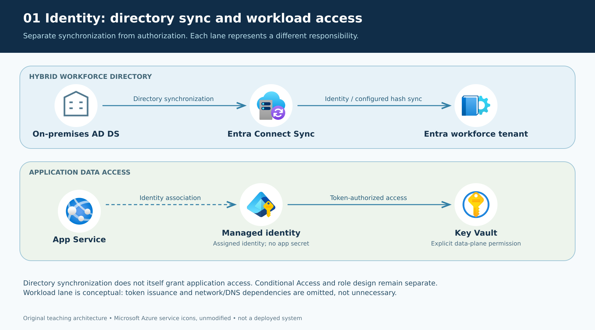

# Identity and authorization: separate the gates

**Learning purpose:** Distinguish identity proof, permission, privileged access and secret management across Azure and hybrid systems.

## Azure service architecture plate

Directory synchronization and workload authorization are separate responsibilities. The dashed association is conceptual, not a network hop. Original composition with unmodified Microsoft Azure service icons; not an official reference architecture.

## Select an identity architecture before selecting a licence

**Verification date: 15 November 2026.** This section is original instruction based on linked Microsoft documentation. The examples are fictional design decisions, not deployed configurations. Product packaging changes; licence eligibility and the rights of every benefiting user must be checked before purchase. A licence table is not a quotation or legal entitlement determination.

Three questions prevent a large category of identity mistakes. First, who is the actor: an employee, a partner, a customer, or software? Second, where is the authority for that identity? Third, what operation must that actor perform? An employee directory, a customer sign-up journey and a workload credential solve different problems. The fact that all three produce tokens does not make them interchangeable.

### Identity pattern selection

| Actor and requirement | Candidate pattern | Why it fits | Reject or reassess when |
|---|---|---|---|
| Employees use cloud applications | Workforce tenant and application integration | Central workforce lifecycle and access policy | The population is actually public customers with self-service registration |
| Partner needs a named internal application | External ID B2B collaboration | Partner authenticates using an appropriate external identity while access is controlled locally | Broad internal access is being granted merely to avoid application integration |
| Customers register for a public service | External ID customer identity in an external-tenant configuration | Separates customer journeys from workforce administration | The requirement is a handful of business guests collaborating internally |
| Azure-hosted code accesses an Entra-capable target | Managed identity | Removes an application-managed secret from the supported authentication path | The target cannot accept the resulting identity/token or its data permissions are undefined |

The workforce/customer distinction is documented in [External ID overview](https://learn.microsoft.com/en-us/entra/external-id/external-identities-overview). Managed identities still require target authorization; they are not universal access credentials. [Managed identities overview](https://learn.microsoft.com/en-us/entra/identity/managed-identities-azure-resources/overview).

**Worked decision:** Contoso has 600 employees, 40 contracted clinicians and 80,000 patients. The employees remain in the workforce model. Contractors receive sponsored, reviewed access to specified internal applications. Patients use a customer identity journey. Patient registration must never be interpreted as membership of a privileged workforce group. This is a concluded separation of populations, not a promise that a particular tenant configuration satisfies healthcare regulation.

### Entra licensing: distinguish base identity from additional capabilities

| Offering | Useful decision boundary | When it is insufficient |
|---|---|---|
| Entra ID Free | Basic directory/sign-in needs and supported security defaults | Custom Conditional Access is required |
| Entra ID P1 | Conditional Access and capabilities such as application proxy | Risk-based Conditional Access is required |
| Entra ID P2 | Risk-based identity protection scenarios beyond P1 | A requested newer governance capability is not included in the particular entitlement |
| Entra ID Governance | Advanced lifecycle, entitlement and review requirements under the documented prerequisite licence | It is being mistaken for a substitute for every P1/P2 or unrelated security feature |

P1 and P2 can be standalone or bundled. Governance has prerequisite and step-up arrangements, and some scenarios depend on separately licensed features. Do not infer licence rights from a portal control being visible. [Entra licensing](https://learn.microsoft.com/en-us/entra/fundamentals/licensing), [Governance licensing](https://learn.microsoft.com/en-us/entra/id-governance/licensing-fundamentals).

**Worked licence choice:** Contoso wants to require a compliant device or stronger authentication for sensitive workforce applications. P1 is the first entitlement category to evaluate because the requirement is Conditional Access, not merely the existence of MFA. If it additionally requires policies responding to assessed sign-in/user risk, P2 capabilities enter the evaluation. If it needs advanced joiner/mover/leaver automation, the team evaluates Governance rather than asserting that “P2 includes every governance feature.” The architecture names the needed capability; procurement then confirms the exact eligible offer and population.

For PIM, current Microsoft documentation requires Entra ID P2 or Entra ID Governance entitlements for the applicable users, including relevant eligible/time-bound role holders, approvers and reviewers. P1 alone is not the PIM entitlement. [PIM licensing requirements](https://learn.microsoft.com/en-us/entra/id-governance/licensing-fundamentals#privileged-identity-management).

The distinction matters economically. Buying the most expensive name for every identity can waste money, but buying only for administrators can also leave benefiting users incorrectly licensed. A solution architect should provide a capability-to-population matrix, not guess a tenant-wide licence quantity. Emergency access and exclusions must be intentional and monitored; they must not turn into a parallel unrestricted sign-in path.

### Hybrid authentication selection

| Method | What validates sign-in | Prefer when | Main architectural consequence |
|---|---|---|---|
| Password hash synchronization | Cloud authentication using synchronized password-derived data | Cloud independence from live on-premises validation is valuable and policy permits it | Synchronization health and lifecycle still matter |
| Pass-through authentication | On-premises validation through agents | A justified requirement demands that validation path | Agent and on-premises availability become sign-in dependencies |
| Federation | A separate identity provider | Required capabilities justify federation | More infrastructure and trust dependencies to operate |

Synchronization technology and authentication method are separate decisions. [Hybrid authentication guide](https://learn.microsoft.com/en-us/entra/identity/hybrid/connect/choose-ad-authn).

**Worked selection:** a branch loses its data-centre connection but staff must continue accessing cloud services. Cloud authentication is the preferred candidate when permitted; federation is rejected if its only justification is historical familiarity. If policy requires an on-premises validation path, the design cannot also claim independence from that path. It must show redundant validation infrastructure, connectivity and an accepted outage response. The correct architecture is the one that explains the conflict, not the one with the most identity products.

### Authorization and workload identity lifecycle

Azure RBAC expresses a principal, role and scope. Directory roles and Azure resource roles control different domains. An inherited broad assignment can make a narrow local assignment irrelevant as a safety argument. Management-plane rights and data-plane rights must be evaluated separately. [Azure RBAC overview](https://learn.microsoft.com/en-us/azure/role-based-access-control/overview).

| Workload identity choice | Good fit | Tradeoff to document |
|---|---|---|
| System-assigned | Identity should be tied to one resource lifecycle | Recreating that resource changes the identity and can require re-establishing permissions |
| User-assigned | Identity must survive resource replacement or be deliberately shared | Sharing enlarges the set of workloads capable of exercising its permissions |
| Application registration/service principal with separately managed credential | Integration cannot use a supported managed identity path | Credential custody, rotation and expiry become explicit responsibilities |

A managed identity removes one secret-management burden, not the need to design authorization. Contoso assigns its document processor only the data operations required on its document store. The deployment identity does not receive permanent application data access merely because it deploys the processor. Nevertheless, the operator able to replace the processor’s code may indirectly influence how its workload identity is used. The complete authority chain must therefore be reviewed.

### Key Vault tiers and Managed HSM

| Choice | Select for | Do not confuse with |
|---|---|---|
| Key Vault Standard | Secrets, certificates and software-protected key requirements | Dedicated HSM isolation |
| Key Vault Premium | Vault capabilities plus supported HSM-protected keys | A dedicated single-tenant HSM service |
| Managed HSM | Explicit dedicated cryptographic key custody/isolation requirements | A general secrets or certificate store |

Standard and Premium differ in key protection; Managed HSM is a separate dedicated service with its own authorization and recovery model. [Key Vault overview](https://learn.microsoft.com/en-us/azure/key-vault/general/overview), [Managed HSM overview](https://learn.microsoft.com/en-us/azure/key-vault/managed-hsm/overview).

**Worked selection:** Contoso needs application secrets and TLS certificate lifecycle management but has no dedicated-HSM requirement. A vault is the candidate; Managed HSM is rejected as unnecessary scope and cost. A separate signing-key use case with explicit dedicated custody requirements is assessed independently. Choosing Premium because a policy requires HSM-protected keys does not mean every stored secret becomes an HSM cryptographic key.

Rotation is a coordinated consumer change. A new key or secret version can be valid while an application still references an old version. The design states whether references are version-pinned, how consumers learn about rotation and how old versions are retired. Soft delete addresses recoverable deletion; purge protection restricts a later destructive stage. Recovering a vault does not automatically recreate all role assignments or event subscriptions. [Vault soft-delete and recovery](https://learn.microsoft.com/en-us/azure/key-vault/general/soft-delete-overview).

### On-premises application authorization: protocol and trust still matter

| Dependency | Candidate design | Important boundary |
|---|---|---|
| Supported on-premises web application needs remote workforce access | Entra application proxy with suitable preauthentication and SSO integration | It is not a universal tunnel for every application protocol |
| Legacy Azure-hosted application requires domain join, LDAP or Kerberos/NTLM | Evaluate Entra Domain Services against the required features | It is not identical to administering an unrestricted self-managed AD DS forest |
| Existing on-premises application enforces directory-group permissions | Preserve and deliberately map the required directory authorization model | A successful cloud sign-in does not automatically grant the correct application permission |

[Application proxy](https://learn.microsoft.com/en-us/entra/identity/app-proxy/overview-what-is-app-proxy) provides supported remote web access, with connector and SSO dependencies. [Entra Domain Services](https://learn.microsoft.com/en-us/entra/identity/domain-services/overview) supplies managed domain capabilities. These are separate product choices; a web-access requirement should not be solved by introducing an unnecessary managed domain, and a Kerberos-dependent service should not be described as fixed merely by adding a browser sign-in.

**Concluded hybrid case:** Contoso retains an internal web application whose authorization uses existing directory groups. It selects application proxy as the remote-access candidate, subject to the documented SSO compatibility, and retains explicit application group authorization. It does not grant all authenticated remote employees access. Connector availability, the on-premises application's directory dependency and the network route remain in the service recovery design. For a different application that needs domain-style protocols after moving to Azure, Domain Services enters a separate feature-compatibility decision. The two cases must not be conflated because their trust boundaries differ.
