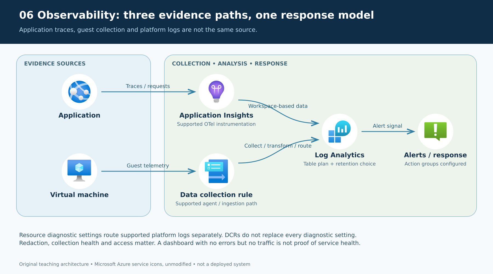

# Observability: design a useful evidence path

**Learning purpose:** Choose telemetry, routing, retention and alerts around service decisions rather than collecting everything.

## Azure service architecture plate

Application tracing and guest collection use different paths. Platform diagnostic settings remain separately configured. Original composition with unmodified Microsoft Azure service icons; not an official reference architecture.

## Design monitoring from the decision the responder must make

Contoso’s incident responders need to answer four different questions: did a platform component fail, did a management change occur, did an application request fail, and did the user’s business operation complete? No single chart answers all four. A monitoring design begins by specifying the evidence needed for each question and the identities allowed to see it.

### Collection and destination selection

| Evidence need | Candidate path | Architectural caution |
|---|---|---|
| Resource/platform logs and supported metrics | Diagnostic settings | Category support varies by resource |
| Management changes | Activity log and appropriate routing | A successful management operation is not application success |
| Application request/dependency behavior | Application instrumentation and Application Insights | Missing instrumentation can look like missing work |
| Supported agent/custom ingestion | Data collection rules | DCRs do not replace every diagnostic-setting scenario |
| Interactive investigation | Log Analytics | Choose access and table behavior, not only a workspace name |
| External event processing/SIEM integration | Supported Event Hubs routing | Downstream retention and consumers must be designed |
| Specific long-lived export requirement | Supported storage destination | Export is not automatically a complete searchable operations experience |

Diagnostic settings define collection and destinations for a resource’s supported data. [Diagnostic settings](https://learn.microsoft.com/en-us/azure/azure-monitor/data-collection/diagnostic-settings). Log Analytics stores tables and supports queries, access controls and retention choices. [Azure Monitor Logs](https://learn.microsoft.com/en-us/azure/azure-monitor/logs/data-platform-logs).

**Worked decision:** the booking API reports a 500 error after calling the payment provider. Platform CPU is normal. The proposed monitoring path correlates the request with dependency timing and a business correlation identifier. A management event records that configuration changed shortly before the failure. These are separate observations; the design does not automatically declare the configuration change causal. The responder needs enough evidence to distinguish provider failure, invalid configuration and application behavior.

### Table plans are not workspace-wide performance tiers

| Table plan | Prefer for | Tradeoff to evaluate |
|---|---|---|
| Analytics | Continuously used operational or detection data | Higher ingestion cost relative to cheaper plans |
| Basic | Supported tables used for troubleshooting and investigation | Query charging and feature restrictions |
| Auxiliary / Lake | Supported low-touch, verbose or retained data | Slower querying and restricted operational capabilities |

A workspace may contain different table plans. Support depends on the table; not every Azure table supports every plan. Switching to Auxiliary/Lake can stop alerts for that table. This is a capability decision, not merely a cheaper storage setting. [Table-plan configuration and limitations](https://learn.microsoft.com/en-us/azure/azure-monitor/logs/logs-table-plans).

**Worked selection:** Contoso’s current application failure events remain on an operationally suitable plan because responders depend on rapid correlation and alerting. Verbose debug data used only after a rare incident is evaluated for a lower-cost supported plan. Audit records have a separate retention requirement. Moving all three to the cheapest plan would confuse different purposes. The cost review therefore works table by table rather than applying one indiscriminate reduction.

### Retention has two different access states

Microsoft distinguishes analytics retention from long-term retention. Current documentation permits Analytics tables to extend analytics retention up to two years; Basic has a 30-day direct-query period, while Auxiliary can be queried through its total retention period under its query constraints. Total retention can extend to 12 years. Search jobs are relevant for older Analytics/Basic data. These are current platform capabilities, not a recommendation to retain everything that long. [Retention documentation](https://learn.microsoft.com/en-us/azure/azure-monitor/logs/data-retention-configure).

A recovery investigator’s need for a record and the ability to query it immediately are different requirements. If the policy says “retain one year,” ask whether the responder also needs interactive analysis of the entire year. Long-term retained data may satisfy preservation while failing an operational response-time expectation. Conversely, keeping rarely used data in an expensive interactive state may add cost without improving any decision.

### An illustrative ingestion calculation

Assume fictional telemetry volumes of 12 GB/day for operational events and 80 GB/day for debug logs. Before retention, indexing or export charges, 30 days represent 360 GB and 2,400 GB of ingestion respectively. These are teaching inputs, not a measured Azure workload or price quote. The debug stream dominates the volume, so reducing harmless duplication there can matter more than deleting critical operational events.

The calculation must not become “drop all large records.” Some low-frequency records are essential for security or recovery. For every filtered field, identify which investigation would lose evidence. For every duplicated destination, identify the independent retention or consumer purpose. Otherwise cost optimization can become evidence destruction disguised as efficiency.

### Alert design and action groups

An alert rule evaluates a signal; an action group routes the response. A notification arriving does not prove the incident was acknowledged or resolved. Select metric, log or management-event alerting based on the signal and supported features, then name the responder and response. [Azure Monitor alerts](https://learn.microsoft.com/en-us/azure/azure-monitor/alerts/alerts-overview).

| Situation | Useful alert reasoning | Avoid |
|---|---|---|
| Rising failed-booking rate | Measure user-impact signal over a defined window | Paging for every single transient exception |
| No expected telemetry | Treat collection silence as its own condition | Interpreting zero errors as health |
| Privileged configuration changed | Route relevant management-event evidence | Assuming all changes are malicious |
| Queue grows faster than workers drain it | Evaluate backlog age and downstream capacity | Scaling workers without checking the dependency bottleneck |

**Worked decision:** a ten-minute deployment window can legitimately increase some transient errors. The design records how maintenance context affects notification, without disabling evidence collection. After the window, persistent user failures still need detection. Suppression should have a time boundary and owner; otherwise a temporary quiet period becomes a permanent blind spot.

### Workspace and access architecture

A single workspace can simplify correlation, while separate workspaces can support operational or jurisdiction boundaries. Neither is universally correct. Start with who needs to investigate which resources and which data they are allowed to see. A centralized operations team may need a cross-workspace view while individual developers need narrower access. The workspace design should not force broad access to sensitive logs merely to diagnose one service.

Contoso therefore writes an access matrix before finalizing its workspace topology. Application responders need request/dependency telemetry for their workload. Security responders need designated security evidence. Finance needs summarized cost data, not raw user activity. The choice of central versus distributed workspace follows those requirements.

The completion criterion for a monitoring architecture is not “a dashboard exists.” It is that required evidence can be collected, retained, accessed and acted on by the intended people within the needed time. This is a design criterion; the course does not claim to have validated a live collection path.
