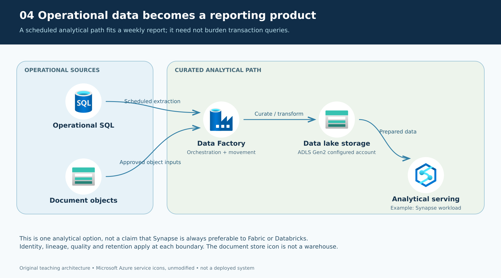

# Documents, objects and integration: design for access patterns

**Learning purpose:** Choose semi-structured and unstructured storage and explain how operational data becomes analytical data.

## Azure service architecture plate

Operational inputs feed a curated analytical path. Synapse is one illustrated serving option, not a universal recommendation. Original composition with unmodified Microsoft Azure service icons; not an official reference architecture.

## 05.1 Cosmos DB is a workload choice before it is a throughput choice

Cosmos DB is a candidate when its supported data model, API, distribution and access behavior suit the application. It should not be selected merely because “NoSQL scales.” A design that needs many cross-entity joins and transactions with broad scope may fit a relational model more naturally. Conversely, a document model can fit aggregates that are usually read and updated together.

Define an aggregate as a business unit of change, not merely a convenient JSON object. If two records must always change atomically, explain whether their placement supports that requirement. If they can change independently, document how consumers handle temporarily different versions. Data-model decisions determine whether distribution simplifies the problem or moves complexity into application code.

## 05.2 Manual provisioned throughput, autoscale and serverless

| Capacity mode | Select when | Reject or qualify when | Architect must model |
|---|---|---|---|
| Manual provisioned throughput | Predictable demand makes a chosen RU/s allocation efficient | A fixed allocation wastes capacity during long low-demand periods | Required throughput, peak duration and scaling operations |
| Autoscale provisioned throughput | Demand varies and automatic adjustment within a configured range is useful | The team assumes it fixes a poor partition key or has no billing floor | Maximum setting, partition/region demand and billing behavior |
| Serverless | Intermittent activity and long idle periods fit a consumption model | Required capabilities or distribution exceed supported serverless constraints | Consumed RUs, storage and current account limitations |

Serverless bills consumed request units rather than reserved RU/s. Autoscale remains a provisioned-throughput model with configured bounds; it is not synonymous with serverless. Current documentation also describes dynamic scaling for nonuniform partition and region demand. [Serverless](https://learn.microsoft.com/en-us/azure/cosmos-db/serverless), [autoscale](https://learn.microsoft.com/en-us/azure/cosmos-db/provision-throughput-autoscale).

**Worked choice.** A rarely used internal approval application starts with serverless on the shortlist, subject to its supported capabilities. A globally active customer workload with unpredictable peaks selects autoscale provisioned throughput over serverless: serverless accounts support only one Azure region, so they cannot meet this fictional multi-region requirement. A high, stable stream may make manually provisioned capacity competitive. The architect does not declare a winner from traffic volume alone: required regional behavior and the actual cost of operations also matter.

## 05.2A Make throughput cost calculable

For manual provisioned throughput, model RU/s multiplied by billed hours and the applicable regional rate. For autoscale, model the billed high-water capacity within each billing interval, subject to current scaling behavior and applicable rates. For serverless, model consumed RUs plus storage. These are different units: RU/s is capacity; RU is work consumed. [Manual versus autoscale](https://learn.microsoft.com/en-us/azure/cosmos-db/how-to-choose-offer).

With a fictional autoscale maximum of 8,000 RU/s, the documented ordinary range is 800–8,000 RU/s. The lower bound is not zero. If a burst reaches the maximum briefly, billing is not calculated merely by averaging the entire hour's business requests. Dynamic partition/region scaling and multi-region write pricing can change the economic comparison, so the simple single-region comparison is not universal.

**Concluded choice:** for a workload that continuously uses nearly all of a stable allocation, manual provisioned capacity is the selected candidate. For irregular peaks that the business cannot schedule, autoscale is selected despite its different unit pricing. For infrequent activity confined to one region, serverless remains a candidate. The recommendation states the demand pattern, distribution requirement and cost unit together.

## 05.3 Partitioning constrains both efficiency and correctness

The partition key determines logical grouping and affects distribution, query routing and transaction scope. A large number of possible values can help distribution, but cardinality alone is insufficient if almost all requests target one value. Conversely, a random value can distribute writes while making the dominant query expensive. The [partitioning guide](https://learn.microsoft.com/en-us/azure/cosmos-db/partitioning) explains logical versus physical partition behavior; its ordinary logical-partition size boundary must not be generalized without considering the chosen partitioning features.

**Worked design: tenant-based records.** Contoso has thousands of small tenants and one very large tenant. A simple tenant identifier is convenient because most queries are tenant-scoped, but the large tenant may concentrate storage and demand. A hierarchical or more granular design may help only if it preserves the important query and transaction behavior. The architect compares the large tenant’s expected growth separately rather than hiding it inside average tenant statistics.

**Illustrative RU calculation.** Suppose a representative fictional read uses 4 RU and occurs 300 times per second. That operation class accounts for 1,200 RU/s. Add writes, queries, indexing effects and headroom; do not round the result into a production SKU without considering partitions. A query that scans many partitions can dominate cost even if most operations are cheap point reads. The operation charges in this example are invented teaching inputs, not documented fixed charges.

## 05.4 Consistency is visible to users

| Consistency option | What the application reasons about | Illustrative fit |
|---|---|---|
| Strong | Reads reflect the latest committed item state under the supported semantics | Freshness is mandatory and its latency/availability tradeoff is accepted |
| Bounded staleness | Staleness is bounded rather than arbitrary | A defined lag tolerance is part of the requirement |
| Session | Guarantees apply within a client session | A user expects to see their own update |
| Consistent prefix | Updates are not observed out of order | Ordered progression matters more than immediate freshness |
| Eventual | Replicas can temporarily diverge | A counter or catalog view tolerates delay |

These are not five performance SKUs. They are application-visible guarantees with tradeoffs. The chosen API and account settings matter. [Cosmos DB consistency](https://learn.microsoft.com/en-us/azure/cosmos-db/consistency-levels).

A fictional social counter can tolerate delay; allocating the final available seat cannot be justified by that same tolerance. A profile editor may need read-your-writes behavior but not globally linearizable access for every reader. The architect identifies the business consequence of stale data rather than choosing the strongest level by reflex. Stronger consistency can simplify some reasoning while increasing coordination costs; weaker consistency can improve some performance characteristics while moving responsibility into the application.

## 05.5 Object, file and analytical namespace are different interfaces

| Storage form | Primary reason to select | Poor reason to select |
|---|---|---|
| Blob Storage | Object/API access to binary assets and documents | Pretending it is a normal file share without adapting access |
| Azure Files | An application requires supported SMB or NFS file semantics | Using a file protocol solely because the developer knows drive letters |
| Data Lake Storage capabilities | Analytics benefits from hierarchical namespace and file/directory operations over object storage | Assuming enabling the feature creates a warehouse or analytics engine |

Azure Files planning includes protocol, media/performance tier, identity, networking, redundancy and management model. A share does not simultaneously provide both SMB and NFS semantics. The supported combinations differ; do not copy an SMB redundancy choice blindly to NFS. [Azure Files planning](https://learn.microsoft.com/en-us/azure/storage/files/storage-files-planning).

Data Lake Storage adds analytics-oriented capabilities to Blob Storage, notably hierarchical namespace. It is storage, not the processing engine. Permissions and namespace design should reflect the processing jobs and data ownership. [Data Lake Storage](https://learn.microsoft.com/en-us/azure/storage/blobs/data-lake-storage-introduction).

**Worked decision.** An unchanged legacy application expects a mounted file share and locking semantics, so Azure Files is the candidate. A new image service reads and writes objects by identifier, so Blob Storage is the candidate. An analytics team organizes partitioned datasets for processing, making Data Lake Storage capabilities relevant. The services are not ranked from basic to advanced; they satisfy different contracts. Azure Files does not support secondary-region reads through RA-GRS or RA-GZRS, so a Blob read-access design cannot simply be reused for a file share. [Azure Files redundancy](https://learn.microsoft.com/en-us/azure/storage/files/files-redundancy).

## 05.5A Azure Files: media, protocol and geography constrain the plan

| Requirement | Candidate direction | Eliminated assumption |
|---|---|---|
| Latency/IOPS-sensitive file access | Evaluate SSD file shares | Lowest capacity cost automatically wins |
| Cost-oriented SMB share with geographic replication | Evaluate supported HDD SMB plus GRS/GZRS | SSD automatically offers the same geographic options |
| NFS file semantics | Evaluate supported NFS configuration | The same share also serves SMB |
| Direct reads from a replicated secondary region | Azure Files does not provide RA-GRS/RA-GZRS behavior | A Blob-style secondary read endpoint exists |

The current [Files redundancy documentation](https://learn.microsoft.com/en-us/azure/storage/files/files-redundancy) restricts GRS/GZRS to HDD SMB shares; SSD shares use LRS or ZRS. A file workload needing both SSD characteristics and regional recovery therefore needs a separately designed supported recovery arrangement, not an impossible SKU combination.

**Concluded choice:** Contoso's ordinary departmental SMB share prioritizes cost and geographic protection over low-latency SSD behavior, so supported HDD SMB with geographic redundancy is selected. Its latency-sensitive Linux workload is evaluated separately with NFS/SSD and an explicit recovery design. Combining them into one universal share is rejected because their protocol and continuity requirements differ.

## 05.6 Access tier is a lifecycle decision

| Blob tier | Access behavior | Typical decision | Important cost/performance concern |
|---|---|---|---|
| Hot | Online | Frequently accessed or changing content | Storage cost versus lower access charges |
| Cool | Online | Less frequent access | Access charges and early-deletion economics |
| Cold | Online | Rare access that still needs prompt retrieval | Higher access cost tradeoff |
| Archive | Offline until rehydrated | Long retention with flexible retrieval time | Rehydration time and minimum-duration economics |
| Smart tier, where supported | Automatically adjusts among online tiers | Usage-based tier management is suitable | Current support and eligibility must be checked |

The current documentation lists minimum storage-duration economics of 30, 90 and 180 days for cool, cold and archive respectively, and distinguishes offline archive from online tiers. These tier choices apply to supported block blobs, not universally to every storage object. [Blob access tiers](https://learn.microsoft.com/en-us/azure/storage/blobs/access-tiers-overview).

**Worked choice.** Contoso has records retained for years but occasionally needed immediately for customer support. Archive is rejected for the immediately required subset even if its storage price is attractive. A separate subset whose retrieval can wait may use archive under an approved lifecycle policy. Archive supports LRS, GRS and RA-GRS, not ZRS, GZRS or RA-GZRS. A requirement for an archive tier therefore rules out those incompatible account combinations. “Old” and “rarely accessed” do not automatically mean “can wait hours.” The architecture splits those requirements rather than forcing one tier across the entire archive.

## 05.7 Redundancy and historical protection are independent

| Redundancy pattern | Failure boundary addressed | Does not establish |
|---|---|---|
| LRS | Multiple copies within a primary location | Zone or regional recovery |
| ZRS | Zone-level resilience within a supported region | Regional disaster recovery |
| GRS | Geographic replication in addition to primary local redundancy | Zero lag or writable active-active behavior |
| GZRS | Primary-zone resilience plus geographic replication | Historical recovery from a valid but mistaken update |
| Read-access variants | Supported reads from a secondary | Automatic write access to that secondary |

The [Storage redundancy guide](https://learn.microsoft.com/en-us/azure/storage/common/storage-redundancy) makes replication direction and secondary read access distinct choices. A service’s supported redundancy combinations still need checking. Replication can propagate unwanted changes, so retention and recovery features remain necessary.

**Worked incident.** A user accidentally replaces a valid document. Replication faithfully distributes the replacement. The correct response depends on a retained version or another supported recovery mechanism, not on having more identical copies of the new content. For a physical zone outage, the reasoning is different: historical versions alone do not provide an available serving endpoint. This is why protection design names the threat before choosing the mechanism.

## 05.8 Choose an analytical platform from processing and consumption

| Candidate | Strong reason to evaluate | Do not confuse it with |
|---|---|---|
| Fabric | Integrated analytics, engineering, warehouse and reporting experiences suit the operating model | A universal requirement for every Azure application |
| Azure Databricks | Engineering, lakehouse and data/AI workflows fit the team and requirements | A simple file store |
| Synapse SQL | Existing Synapse estate or a justified SQL analytical pattern | The transactional database’s replacement by default |
| Azure Data Explorer | High-volume telemetry/time-oriented analytical querying fits | A general transaction engine |
| Stream Analytics | Managed processing of event streams with suitable query patterns | Durable source-of-truth storage |
| Data Factory | Orchestration and movement between systems | The analytical serving database itself |

[Fabric](https://learn.microsoft.com/en-us/fabric/fundamentals/microsoft-fabric-overview), [Databricks](https://learn.microsoft.com/en-us/azure/databricks/introduction/), [Synapse SQL](https://learn.microsoft.com/en-us/azure/synapse-analytics/sql/overview-architecture), [Data Explorer](https://learn.microsoft.com/en-us/azure/data-explorer/data-explorer-overview), [Stream Analytics](https://learn.microsoft.com/en-us/azure/stream-analytics/stream-analytics-introduction).

Current Microsoft guidance points new warehouse evaluations toward Fabric, but that does not mean every existing Synapse workload should migrate immediately. The architect considers contractual constraints, existing skills, integration, economics and migration risk. A course must distinguish current vendor direction from an organization-specific decision.

For Synapse SQL, distinguish on-demand query behavior over data from dedicated analytical capacity. A dedicated resource can fit predictable heavy analytical workloads; querying data without provisioning that same capacity can fit other patterns. Avoid treating “serverless” across SQL Database, Synapse and Cosmos DB as one shared feature with identical semantics.

## 05.9 Data movement needs an execution location

Data Factory integration runtimes connect the orchestration definition to actual execution. Azure integration runtime, self-hosted integration runtime and Azure-SSIS integration runtime serve different needs, including cloud movement, network-accessible private/on-premises work and supported SSIS execution. The design selects runtime placement according to source access and processing requirements. [Integration runtime](https://learn.microsoft.com/en-us/azure/data-factory/concepts-integration-runtime).

**Worked pipeline.** Contoso imports nightly records from an on-premises source inaccessible from the public internet. A pipeline definition alone cannot reach it. The design identifies a supported execution location with the necessary network access, assigns an owner for its availability and protects its credentials. The copied data then lands in a raw zone, is validated and transformed, and is published to a curated reporting dataset. The transition from raw to curated is an explicit quality boundary, not a folder rename.

**Concluded analysis design.** Weekly utilization reporting accepts a 24-hour lag, so batch ingestion and a curated warehouse-style dataset are selected. A separate queue-surge signal requires prompt event processing, so a stream path is evaluated. Combining both into a continuously running complex streaming architecture is rejected because it does not improve the weekly business decision. Each path has a freshness contract, duplicate handling and an accountable owner.
