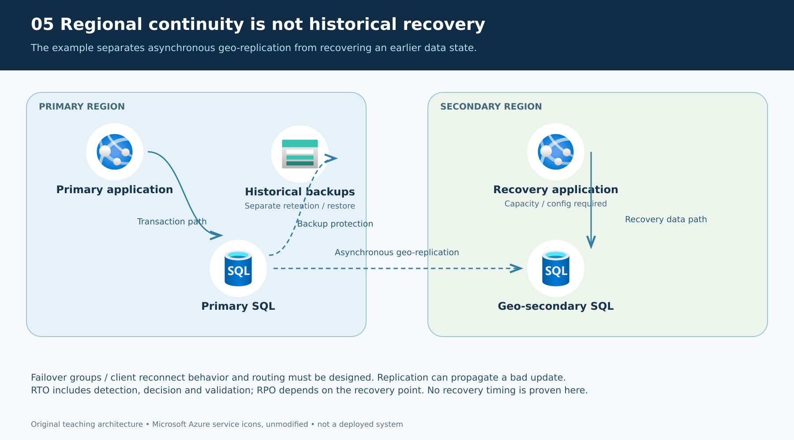

# Continuity: recovery objectives before redundancy

**Learning purpose:** Separate high availability, backup and disaster recovery, and explain end-to-end recovery across compute and data.

## Azure service architecture plate

Geo-replication addresses regional continuity; historical backup addresses recovery of earlier state. Neither alone proves end-to-end recovery. Original composition with unmodified Microsoft Azure service icons; not an official reference architecture.

## 06.1 First classify the failure

| Failure | Candidate mechanism | Why a different mechanism may be insufficient |
|---|---|---|
| Single node failure | Service-native local redundancy | A backup may restore eventually but not meet availability needs |
| Zone outage | Supported zone-redundant deployment | Two instances in the same failure domain may fail together |
| Region outage | Cross-region arrangement or geographic restore | Zone redundancy remains inside one region |
| Accidental valid update | Point-in-time/version recovery | Replication may copy the unwanted update |
| Key or identity dependency loss | Recovery of access and supporting dependencies | Healthy data bytes alone do not make the application usable |
| Application regression | Compatible release rollback or forward fix | Database failover does not repair incorrect application logic |

A continuity plan can use several mechanisms because the incidents differ. It should not claim that one product solves every failure. Recovery targets are business constraints; product capabilities are inputs into the design. The difference prevents an available database from being mistaken for an available user journey.

## 06.2 SQL Database local availability versus zone resilience

SQL Database provides managed local redundancy and servicing, while supported zone-redundant configurations address a larger failure boundary. Application connections can still experience interruptions and require appropriate transient-fault behavior. Zone redundancy is not the same as cross-region recovery. [SQL Database redundancy](https://learn.microsoft.com/en-us/azure/azure-sql/database/high-availability-sla-local-zone-redundancy?view=azuresql).

**Worked design.** Contoso’s booking service must continue through a zone failure. The design evaluates a supported zone-redundant database configuration and application placement, not merely two web instances. If the database remains within one zone, adding frontend instances does not satisfy the end-to-end requirement. If a region-wide event is in scope, a separate regional recovery design is required.

This also affects price comparison. A cheaper configuration that does not meet the failure-boundary requirement is not a competing solution on equal terms. Conversely, paying for cross-region complexity is not justified when the business explicitly accepts a longer regional restoration path and the costs outweigh the benefit.

## 06.3 PITR, LTR and geo-restore serve different purposes

| Mechanism | Best-fit recovery purpose | Required architectural reasoning |
|---|---|---|
| Point-in-time restore | Return to a selected recent historical state | Choose the cutoff and reconcile later legitimate writes |
| Long-term retention | Preserve selected backups for a longer business retention need | Retention governance, access and ongoing storage cost |
| Geo-restore | Rebuild from appropriately replicated backup after regional loss | Availability of backup, restore duration, new resource/access and traffic changes |
| Geo-replication/failover group | Maintain a secondary for regional continuity | Replication lag, failover decision, client behavior and dependencies |

[SQL backup documentation](https://learn.microsoft.com/en-us/azure/azure-sql/database/automated-backups-overview?view=azuresql) distinguishes retention and geo-recovery behavior. A configured backup schedule does not itself establish RTO. Restoring an earlier database state can create a new database and requires application integration decisions; it is not a magical in-place undo of one business transaction.

**Worked recovery.** An erroneous update starts at 10:20 and is discovered at 11:00. Restoring to 10:19 may remove legitimate work performed during the next 41 minutes. The technical restore point is only one input. The business owner must determine how to recover or replay legitimate work without replaying the error. The course does not invent an automated reconciliation capability that the application does not possess.

## 06.4 Failover groups simplify an endpoint, not the whole application

SQL Database failover groups coordinate databases across logical servers and provide listener endpoints that remain stable through geo-failover. Replication is asynchronous, so failure conditions and lag matter. The application still needs connection resilience, and identity/network/configuration dependencies must exist in the target environment. [Failover groups](https://learn.microsoft.com/en-us/azure/azure-sql/database/failover-group-sql-db?view=azuresql).

**Worked failure path.** Contoso’s database secondary is available, but its application in the recovery region lacks the correct workload permission. Database failover succeeds while the customer service remains unavailable. The corrected design treats permission, keys, configuration, DNS, application capacity and dependencies as part of the recovery unit. A successful database operation is evidence about the database operation, not proof of end-to-end recovery.

A deliberate failover decision also considers the former primary. If it returns, the team must prevent split ownership and reconcile state according to the service’s supported behavior. “Turn both on” is not a recovery strategy for a single-writer business system.

## 06.5 PostgreSQL availability is not the same as a read replica

PostgreSQL flexible server supports managed HA arrangements, including same-zone and zone-redundant patterns where available. Its HA standby supports availability; it should not be assumed to be the application’s read-scaling endpoint. Read replicas and regional recovery choices address different objectives. [PostgreSQL HA](https://learn.microsoft.com/en-us/azure/postgresql/high-availability/concepts-high-availability).

**Worked decision.** Contoso needs continuity through an infrastructure failure and also wants to isolate heavy reports. It cannot satisfy both requirements merely by writing “one replica.” It chooses the appropriate supported HA configuration for availability and separately evaluates a read or analytical path for reporting. The design records any freshness difference on the reporting path. Reporting performance must not be improved by reading from a component that is not intended to serve that purpose.

## 06.6 Cosmos DB: availability, consistency and backup remain separate

Cosmos DB for NoSQL supports zone and regional reliability options, with single-write or multi-write designs and backup choices. The client’s regional configuration and application consistency requirements affect recovery behavior. Multi-region capability does not mean every operation remains available with identical semantics under every failure. [Cosmos DB reliability](https://learn.microsoft.com/en-us/azure/reliability/reliability-cosmos-db).

**Worked choice.** Contoso’s public catalog can tolerate stale reads, so geographically distributed reading is useful. It retains a governed single-write approach because the team does not need concurrent regional edits. That simplifies conflict ownership but creates a write-continuity tradeoff during failover. A separate workload requiring active writes in multiple regions must define conflict behavior rather than copy this design unchanged.

A backup is still required for logical mistakes. Multiple regions can all contain the same mistaken change. Periodic or continuous backup capability must be selected and validated for the chosen account and API. This chapter explains the decision but does not claim every backup mode is available in every combination.

## 06.7 Blob recovery and retention controls

Blob protection can combine soft deletion, versioning, point-in-time recovery where supported, backup and immutability. Each protects a different event and has prerequisites or compatibility constraints. An immutable retention rule can deliberately prevent later deletion, so it needs governance rather than casual enablement. [Blob data protection](https://learn.microsoft.com/en-us/azure/storage/blobs/data-protection-overview).

**Worked policy.** Working documents need recovery from accidental replacement; final retained records need protection against alteration for an approved period. The team uses different lifecycle controls for those categories. It does not impose permanent immutability on every temporary upload, nor assume soft delete satisfies a legal hold. The decision records the owner of retention and the consequences of a mistake in the policy itself.

## 06.8 End-to-end RTO is a budget, not a service setting

Assume fictional requirements of a 30-minute RTO and five-minute RPO. The team allocates three minutes to detection, two to decision, ten to technical recovery, five to validation and five to traffic restoration. That totals 25 minutes and leaves five minutes of contingency. These are design allocations, not observed timings. If a required approval takes 20 minutes, the proposed plan fails before any database is restored.

The RPO must be tested independently. A successful 25-minute restoration using data from 15 minutes before the incident violates the five-minute loss tolerance. Conversely, zero lost data is not enough if service returns after the permitted outage. Confusing the two objectives can produce a design that appears resilient while failing the actual business commitment.

| Recovery stage | Evidence needed in a real operation | Common false conclusion |
|---|---|---|
| Detect | Correct incident scope and timeline | Any alert proves a disaster |
| Decide | Authorized strategy and recovery point | A technical operator chooses acceptable data loss alone |
| Recover | Supported operation completes for the intended resources | One component’s success means the service is restored |
| Validate | Identity, data and business behavior are acceptable | An open TCP connection proves correctness |
| Restore traffic | Intended clients reach the recovered service | DNS update means all clients moved instantly |
| Reconcile | Remaining writes and old-primary state are handled | Returning hardware can simply rejoin without review |

## 06.9 Cost and capacity in the recovery environment

A cold recovery pattern may reduce normal running cost but increase deployment and restoration time. A warm standby keeps some capacity prepared but may need to scale during an incident. An active-active pattern can improve certain availability characteristics while increasing coordination, conflict and cost complexity. The choice must include availability of capacity in the target region, not just a saved template.

**Worked comparison.** Contoso has one low-priority reporting service with a recovery tolerance measured in a day and a booking service with a 30-minute target. The reporting service can reasonably use a less expensive restoration strategy. Applying that strategy to booking solely to keep the architecture uniform would ignore the different business values. Equally, applying a costly always-active second region to every report would spend money without a corresponding requirement.

A recovery bill includes standby compute, replicated data, additional reads or writes, backups, networking and operations. No actual currency figure is asserted here because it depends on current region, SKU and quantities. A meaningful estimate must compare designs meeting the same recovery requirement.

## 06.10 Compute and hybrid recovery

Compute continuity requires three different designs: keep serving during a component failure, recover service after losing a location, and restore an earlier clean state. A healthy replacement VM does not recover a deleted database. Conversely, a retained backup does not route traffic or start dependent application tiers. Select the failure mechanism first, then the service. Current Microsoft guidance checked 15 November 2026 distinguishes Azure Backup's data protection from Site Recovery's replication and failover orchestration. [Azure Backup overview](https://learn.microsoft.com/en-us/azure/backup/backup-overview), [Site Recovery overview](https://learn.microsoft.com/en-us/azure/site-recovery/site-recovery-overview).

| Requirement | Select | Important boundary or rejected alternative |
|---|---|---|
| Survive host/rack faults for multiple VMs in one datacenter | Availability set with fault/update-domain distribution | Not protection against a complete zone or region failure; multiple application instances and traffic distribution are still necessary. |
| Continue serving after losing a zone | Application instances distributed across availability zones, with resilient load balancing and data | A single zonal VM is not a multi-zone application. Disk redundancy does not independently make its guest application highly available. |
| Manage and scale a repeatable VM fleet | Virtual Machine Scale Sets with deliberate zone placement and health/repair policies | Autoscaling is capacity management, not data replication; orchestration mode affects supported protection features. |
| Recover supported Azure or on-premises machines into another location | Azure Site Recovery | Replication can reproduce corruption. It does not replace retained backups or automatically repair application dependencies. |
| Recover older files, disks, machine state or supported application data | Azure Backup, with workload-appropriate protection | Restore latency and recovery-point frequency must fit objectives; backup alone is not an orchestrated hot standby. |

Availability sets and zones address different failure domains. A scale set can organize instances across zones, but the application must tolerate instance loss and retain enough surviving capacity. For example, three equal instances at 70% utilization cannot sustain unchanged load on two equal survivors without overload: total demand is 2.1 instance-equivalents, exceeding the remaining two. Provision headroom or accepted degradation, rather than assuming distribution guarantees performance. [VM availability options](https://learn.microsoft.com/en-us/azure/virtual-machines/availability).

For hybrid backup, the MARS agent protects supported Windows files, folders and system state; it is not a universal Linux or whole-datacenter protection agent. MABS or DPM provides a backup-server approach for supported workloads. Azure VM backup uses its VM protection integration. Select the application-aware method where transactional consistency is required, and distinguish recovering a complete VM from recovering individual application records. [Azure Backup architecture](https://learn.microsoft.com/en-us/azure/backup/backup-architecture).

### Managed compute changes responsibility, not recovery requirements

App Service zone redundancy currently uses supported Premium v2–v4 plans with at least two instances and a suitable regional scale unit. Two nonzonal workers are not equivalent. Regional continuity additionally needs a second deployment, traffic management, configuration and identity availability, and recovered dependencies. A deployment slot provides release isolation, not a second-region disaster-recovery site. [App Service reliability](https://learn.microsoft.com/en-us/azure/reliability/reliability-app-service).

Functions zone support depends on the hosting plan: classic Consumption does not support zones; Flex Consumption and Premium support zone-redundant deployments, while Dedicated follows supported App Service arrangements. Zone-resilient host storage is part of the design. For zone-redundant Flex Consumption, the platform maintains at least two billed always-ready instances per scaling function or group; this configuration cannot retain a scale-to-zero cost assumption. The resilience choice therefore changes the minimum running cost, not merely a checkbox. Retried queue work must be idempotent: a recovered worker can encounter a message whose side effect completed before acknowledgment failed. Do not promote a second regional consumer without considering duplicate processing and data ownership. [Functions reliability](https://learn.microsoft.com/en-us/azure/reliability/reliability-functions).

For Container Apps, replica distribution in a zone-redundant environment protects against zone loss; regional recovery still requires another environment, available images/configuration and an external-data recovery strategy. A new revision restores application code, not necessarily its database schema or persisted state. [Container Apps reliability](https://learn.microsoft.com/en-us/azure/reliability/reliability-azure-container-apps).

### Concluded hybrid VM decision

Fictional Contoso retains a supported on-premises VM application because its vendor requires guest-level installation. Its agreed objectives are a 60-minute site-outage RTO and 15-minute RPO, plus recovery of files deleted up to 30 days earlier. These are business requirements, not Microsoft guarantees. Select Site Recovery for the supported machines' site-failure path and a separate supported backup policy for historical recovery. Reject backup-only recovery because reconstructing the application stack after the outage is not a credible, unmeasured 60-minute plan. Reject replication-only protection because yesterday's deletion may already exist in the replica.

The recovery design pre-establishes Azure network, name resolution, identity connectivity, target capacity and licensing. Order recovery by dependencies: identity/name resolution, data services, application services, then ingress. A proposed budget allocates 10 minutes to decision-making, 20 to machine recovery, 15 to application/data validation and 15 to traffic restoration. These figures remain unproven until an authorized rehearsal measures them; replication lag must also demonstrate the RPO. A test failover uses an isolated network to avoid duplicate identities and unintended production transactions. After recovery, reprotection and failback require their own planned sequence rather than simply restarting the original machines. This selects the mechanisms while honestly withholding a claim of achieved recovery time. [Site Recovery overview](https://learn.microsoft.com/en-us/azure/site-recovery/site-recovery-overview).

## 06.11 What this section establishes and what remains unverified

This section provides concrete service and plan-selection reasoning, recovery mechanisms and original worked cases. It does not establish current eligibility for every region, maximum capacity for every SKU, a tenant’s licensing, exact prices or measured failover times. Those are changeable implementation facts. The linked primary documents were checked on 15 November 2026; product pages should be rechecked before a real decision.

No live resources, credentials, subscriptions or recovery operations were used. No laboratory, practice-examination or video content was added. These boundaries do not make the teaching generic: the tables state actual choices and the examples conclude decisions, while preserving the distinction between a defensible design and a validated deployment.
