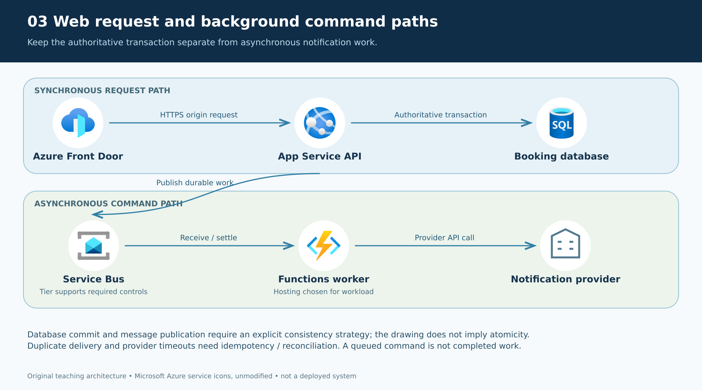

# Application architecture: decouple without losing correctness

**Learning purpose:** Explain messaging, events, APIs, caching, configuration and deployment as connected design decisions.

## Azure service architecture plate

The transaction and notification paths are separate. A durable command is not proof of provider completion. Original composition with unmodified Microsoft Azure service icons; not an official reference architecture.

## 8.1 Establish message meaning before selecting a tier

A command asks another component to do work. An event announces a fact. A stream is a sequence of records intended for continuous ingestion and potentially independent replay. These meanings lead to different consumer behavior. A queue acknowledgement means something different from advancing a stream checkpoint, and neither should be confused with a human receiving an email.

| Requirement | Candidate direction | Why |
|---|---|---|
| Durable business work with explicit processing and failed-message handling | Service Bus | Brokered work distribution and enterprise messaging semantics |
| React to a resource or application event | Event Grid | Event routing to interested handlers |
| Ingest high-volume telemetry for independent consumers | Event Hubs | Partitioned stream and consumer progress model |
| Immediate answer required from a dependency | Synchronous API | Caller truly needs the result before continuing |

The table is an original interaction-selection model. It avoids the common error of calling all four “a queue.” An architect should also ask whether an asynchronous interaction changes the user contract. If the interface says “invoice created,” then accepting an invoice request into a queue is not yet enough evidence to display that statement.

## 8.2 Service Bus Basic, Standard and Premium

Basic supports queues. Standard adds capabilities including topics/subscriptions, sessions, transactions and duplicate detection on shared capacity. Premium uses dedicated messaging units and includes capabilities such as private networking and larger-message support. Tier selection therefore concerns both features and workload isolation. [Microsoft: Service Bus tiers](https://learn.microsoft.com/en-us/azure/service-bus-messaging/service-bus-premium-messaging)

| Tier | Use when | Reject when |
|---|---|---|
| Basic | Simple queue requirement fits its feature set | Topics, sessions or another unsupported capability is required |
| Standard | Rich brokered messaging fits shared-capacity behavior | Dedicated performance isolation or Premium networking is a hard requirement |
| Premium | Isolation, predictable capacity or Premium-specific capability justifies it | The workload has no requirement that benefits from the baseline capacity cost |

**Worked choice:** Contoso needs separate accounting and notification subscribers to react to a booking transaction, and it needs ordering within a business conversation. Standard is a candidate because Basic does not fit the required broker capabilities. If the namespace must use a supported private connectivity design requiring Premium, that requirement changes the tier decision even when message volume is small. A small workload does not automatically mean a low tier is technically sufficient.

Dead-letter handling needs an owner and business interpretation. A malformed invoice request should not loop forever. A dead-letter record may require correction and an explicitly controlled resubmission. Reprocessing can duplicate effects if the first processing attempt partly succeeded. The design must keep the original business identifier and distinguish “never attempted” from “outcome uncertain.”

Ordering also has a scope. Ordering within an identified conversation is different from global ordering across all business activity. Requiring global ordering unnecessarily can limit concurrency. Specify the actual business invariant: for example, changes to one appointment must be interpreted coherently, while unrelated appointments can proceed independently.

## 8.3 Event Grid Basic and Standard

Event Grid Basic focuses on push delivery from system, custom and partner topics or domains. Standard uses namespaces and supports MQTT, HTTP CloudEvents and flexible consumption including pull delivery. The two tiers differ in resource model and capabilities; Standard is not merely a larger quota setting for every Basic feature. [Microsoft: Event Grid tier choice](https://learn.microsoft.com/en-us/azure/event-grid/choose-right-tier)

| Requirement | Candidate | Design implication |
|---|---|---|
| React to supported Azure resource events through push handlers | Basic | Handler availability, retries and dead-letter strategy matter |
| MQTT publish/subscribe | Standard | Design client identity and topic permissions |
| HTTP consumers must control when they receive events | Standard | Pull-consumer lifecycle and acknowledgements matter |
| Existing Basic topic estate | Assess compatibility before migration | Do not assume every resource maps one-to-one |

**Worked choice:** a Blob-created event launches a thumbnail process. Basic is the initial event-routing candidate because the desired action follows an Azure resource event. A different connected-device application requiring MQTT directs the design toward Standard. Calling both “event-driven” does not make their protocol and resource requirements identical.

The thumbnail service still needs to tolerate duplicate or late notification. An event may be an indication to inspect the authoritative object, not an excuse to assume the payload contains every current property. If the object has changed again, the consumer needs a version-aware policy. Event routing does not resolve application concurrency automatically.

## 8.4 Event Hubs: tier, partitions and consumer progress

Basic is for simpler streaming needs; Standard adds broader production capabilities such as multiple consumers, Capture and Kafka support; Premium adds resource isolation and features such as customer-managed keys and dynamic partition scale-out; Dedicated supplies a single-tenant cluster for demanding scale. Feature support must be checked, especially geographic recovery versus data replication. [Microsoft: Event Hubs tiers](https://learn.microsoft.com/en-us/azure/event-hubs/compare-tiers)

| Tier direction | Typical decision trigger | Important caveat |
|---|---|---|
| Basic | Simple, limited stream consumption | Limited feature/consumer requirements must genuinely fit |
| Standard | Multiple analytical consumers and common streaming integrations | Shared capacity and quotas still constrain the design |
| Premium | Isolation, advanced security or partition growth requirement | More capacity does not repair a badly skewed partition key |
| Dedicated | Large workload requiring single-tenant cluster capacity | Dedicated infrastructure has a substantial cost commitment |

Standard throughput units constrain ingress and egress, while partitions determine how processing can be distributed. The documented unit provides up to 1 MB/s or 1,000 events/s ingress, whichever is reached first, and separate egress limits. Consumers share namespace capacity; partitions do not create unlimited bandwidth. [Microsoft: Event Hubs scalability](https://learn.microsoft.com/en-us/azure/event-hubs/event-hubs-scalability)

**Worked calculation:** a fictional stream produces 5,000 events per second at 100 bytes each. Raw payload is about 0.5 MB/s, yet the event-count dimension is more restrictive than that byte estimate. Protocol overhead, headroom and consumers still need consideration. Conversely, a small number of large events can hit a byte limit before an event-count limit. The architecture should show which constraint drove its capacity estimate.

A consumer checkpoint is a record of progress, not a transaction across all external effects. If a processor writes to a database and crashes before its checkpoint advances, replay may repeat the write. Idempotent or deduplicated processing remains necessary. Separate consumer groups allow independent progress; they do not automatically make every consumer’s downstream output consistent with every other consumer.

## 8.5 API Management: use the actual feature matrix

API Management classic and v2 tiers must not be treated as interchangeable. Developer is for non-production evaluation and lacks an SLA. Consumption emphasizes usage-based gateway operation but lacks several dedicated-tier features. Network injection, outbound private access, inbound private endpoints, multi-region and self-hosted gateway capabilities differ across tiers. [Microsoft: APIM feature comparison](https://learn.microsoft.com/en-us/azure/api-management/api-management-features)

| Requirement | Candidate direction to verify | Common wrong assumption |
|---|---|---|
| Non-production policy evaluation | Developer | Developer is a low-cost production tier |
| Simple usage-based gateway | Consumption | It includes every developer-portal/network capability |
| v2 dedicated gateway with modest requirements | Basic v2 | Private-backend access is identical to Standard v2 |
| v2 gateway reaching isolated backends | Standard v2 | Outbound integration equals full network injection |
| Classic production multi-region or self-hosted gateway requirement | Premium classic | Premium v2 automatically has classic feature parity |
| Full v2 virtual-network injection | Premium v2 | Outbound integration is equivalent to injection |
| v2 zone redundancy | Standard v2 or Premium v2 in supported regions | Zone support implies multiregion or full network injection |

**Documentation nuance checked 15 November 2026:** the current [APIM reliability guidance](https://learn.microsoft.com/en-us/azure/reliability/reliability-api-management) states that Standard v2 supports availability zones in supported regions, while the general feature matrix still shows otherwise. Treat zone redundancy separately from network injection and confirm the supported region and creation-time configuration in the [zone-enablement guidance](https://learn.microsoft.com/en-us/azure/api-management/enable-availability-zone-support). Do not use the older matrix alone to rule out Standard v2.

The v2 family is a distinct platform generation. Verify migration support and feature compatibility before treating an upgrade as an in-place change. The current v2 documentation is the relevant starting point for Basic v2, Standard v2 and Premium v2, rather than an old classic-tier diagram. [Microsoft: APIM v2](https://learn.microsoft.com/en-us/azure/api-management/v2-service-tiers-overview)

**Worked choice:** Contoso has public partner clients but an isolated backend. The architect first decides whether clients reach a public or private gateway, then separately decides how the gateway reaches the backend. Standard v2 may fit a supported outbound private-backend integration requirement. If the gateway itself must be injected into the virtual network, the shortlist changes. If multi-region within one classic service is essential, the current matrix points toward the appropriate classic capability rather than assuming Premium v2 supplies it.

An API gateway is not a replacement for business authorization. Validating a token establishes selected identity claims; the backend must still decide whether that caller can amend this appointment. A policy can enforce rate controls, transformations and other gateway behavior, but a poorly chosen policy can also break clients or expose data. Version policies with the API contract and test compatibility in an authorized engineering workflow outside this course.

## 8.6 Redis and configuration: capacity is not only memory

Azure Managed Redis offers Memory Optimized, Balanced, Compute Optimized and Flash Optimized families. These emphasize different memory/compute ratios or use flash for colder data. Flash is not a substitute for persistence or a stronger resilience guarantee. Feature availability and preview status vary by SKU; choose from the current table rather than transferring old Azure Cache for Redis tier names. [Microsoft: Managed Redis](https://learn.microsoft.com/en-us/azure/redis/overview)

| Workload evidence | Candidate family | Rejection reason |
|---|---|---|
| Large hot dataset, modest command rate | Memory Optimized | Compute/network demand actually dominates |
| Balanced ordinary workload | Balanced | A measured skew needs specialization |
| High command-processing demand | Compute Optimized | Extra compute adds little to a capacity-only problem |
| Large dataset with colder portion and acceptable access tradeoff | Flash Optimized | Predictable all-memory behavior or unsupported feature is essential |

**Worked choice:** Contoso’s catalog cache occupies substantial memory but performs relatively few operations. Memory Optimized is a candidate. A separate high-traffic leaderboard with smaller data but heavy command processing may favor Compute Optimized. Selecting solely by dataset size would miss this distinction. Neither selection is final without observing command mix, connections and network throughput.

A cache design must define source of truth, TTL, invalidation and degraded operation. Cache-aside loads missing entries from the authoritative store. A simultaneous expiry can generate a surge of source reads. The application should not fail catastrophically merely because an expendable cache is empty. For permissions or financial balances, the acceptable staleness may differ sharply from descriptive catalog content.

App Configuration manages settings and feature availability; Key Vault remains the appropriate place for secrets. Key Vault references can connect the two. A feature flag chooses behavior; a setting supplies a value; a secret grants or protects access. These are not the same lifecycle. [Microsoft: App Configuration purpose](https://learn.microsoft.com/en-us/azure/azure-app-configuration/overview), [Microsoft: App Configuration FAQ](https://learn.microsoft.com/en-us/azure/azure-app-configuration/faq)

| Configuration tier direction | Fit | What to verify |
|---|---|---|
| Free | Small evaluation | Request quotas and absence of production SLA |
| Developer | Non-production needs beyond Free | Throughput and unsupported production assumptions |
| Standard | Production configuration service | Quotas, replication and required features |
| Premium | Higher-scale production requirements | Actual throughput, storage and feature benefit |

**Worked consequence:** 100 application instances polling configuration on every user request can overload a configuration store that would comfortably serve a cached refresh design. Increasing the tier may hide inefficient consumption. The design specifies refresh behavior, last-known-good handling and the maximum acceptable time before a changed flag takes effect. A feature flag that disables booking must not remain stale indefinitely because a client silently stopped refreshing.

## 8.7 Deployment selection: artifact, infrastructure and data

A complete deployment design separates application artifacts, infrastructure definitions, configuration and data evolution. Rebuilding separately for each environment introduces a different artifact into each stage; promoting one identified artifact makes the relationship clearer. Environment-specific values must not be baked into the supposedly identical artifact. A deployment record should connect the source revision, build identity, configuration version and target.

| Rollout pattern | Use when | Main tradeoff |
|---|---|---|
| In-place replacement | Simple workload accepts the exposure and restart behavior | Less isolation between old and new |
| Slot or blue-green switch | Parallel candidate can be validated before traffic switch | Duplicate capacity and shared-data compatibility |
| Canary/progressive exposure | Health can be measured for a controlled subset | More routing and observation complexity |
| Feature flag | Code presence and behavior activation should be separated | Configuration becomes a release dependency |

This is an original deployment decision table, not a claim that every platform supports every pattern identically. App Service slots, Container Apps revisions and Kubernetes rollout mechanisms have different settings and rollback boundaries. Product-specific implementation must be checked after choosing the pattern. Infrastructure-as-code describes intended resources; it does not establish that a change is nondestructive.

**Worked release:** Contoso adds a nullable data field, deploys code that tolerates old and new records, enables the new behavior for a limited cohort, and only later removes obsolete dependencies. The sequence preserves compatibility. Reversing a code rollout after deleting a required database column would not be equivalent. The safe decision is to separate compatible expansion from destructive contraction, with evidence before each transition.

The course does not supply executable pipeline code because that would require repository, identity and environment decisions. It supplies the architectural specification: which identity may build, which may deploy, how authorization is bound to the change, what evidence permits promotion, what stops a rollout and which recovery action remains valid after new writes occur.
