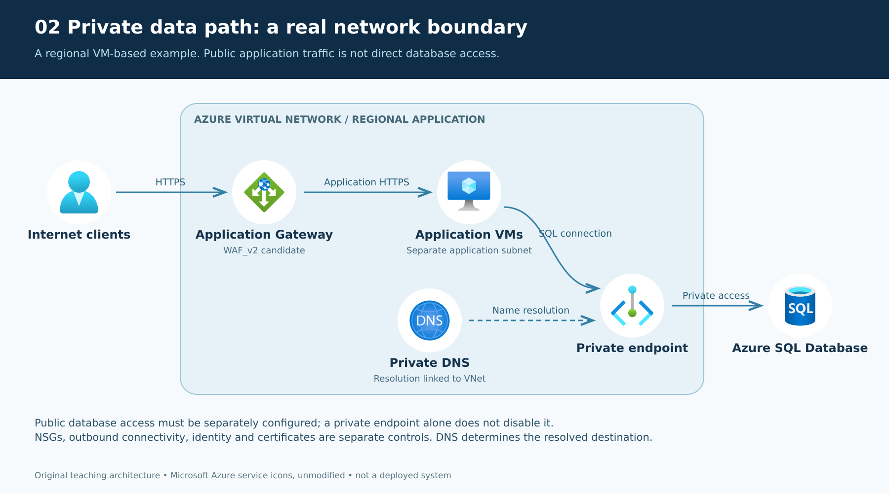

# Networking: draw traffic intent and trust boundaries

**Learning purpose:** Select internet and hybrid connectivity, private access, performance controls and routing based on actual traffic.

## Azure service architecture plate

An example regional VM network uses Application Gateway and a private data endpoint. DNS and public-access settings remain explicit. Original composition with unmodified Microsoft Azure service icons; not an official reference architecture.

## Network selection starts with protocol, geography and trust

A service-selection table becomes meaningful only after the workload states what traffic actually does. Record whether it is HTTP, raw TCP or UDP; whether clients are global or regional; whether TLS terminates at an intermediary; whether the origin may be public; and whether DNS-level steering is acceptable. A requirement for “load balancing” alone is underspecified.

### Delivery and load-balancing decision table

| Service/tier | Prefer when | Reject or reassess when |
|---|---|---|
| Front Door Standard | Global HTTP delivery, caching and routing with supported custom WAF rules | Managed WAF rules or supported Private Link origin access is required |
| Front Door Premium | Those premium security/private-origin capabilities justify cost | A regional internal service needs no global HTTP edge |
| Application Gateway Standard_v2 | Regional application proxy/routing with v2 scaling capabilities | Web attack inspection is required from this gateway tier |
| Application Gateway WAF_v2 | Regional gateway plus WAF requirements | DNS-only steering or simple TCP/UDP distribution is the actual need |
| Standard Load Balancer | TCP/UDP distribution at the network layer | HTTP path routing, caching or WAF is required |
| Traffic Manager | DNS-based selection among public endpoints | A proxy must inspect every request or terminate TLS |

Front Door Premium supports managed WAF rules beyond Standard’s custom-rule capability; verify the exact supported private-origin type. [Front Door comparison](https://learn.microsoft.com/en-us/azure/frontdoor/front-door-cdn-comparison). Application Gateway v2 has Standard_v2 and WAF_v2 behavior plus other SKU distinctions; current documentation also describes TCP/TLS proxy capabilities, so “Application Gateway can only handle HTTP” is outdated. [Application Gateway v2](https://learn.microsoft.com/en-us/azure/application-gateway/overview-v2). Standard Load Balancer and Traffic Manager solve different layers. [Load Balancer SKUs](https://learn.microsoft.com/en-us/azure/load-balancer/skus), [Traffic Manager](https://learn.microsoft.com/en-us/azure/traffic-manager/traffic-manager-overview).

**Worked selection:** Contoso serves a public web application globally and requires managed WAF protection with a supported private origin. Front Door Premium is the candidate; Standard is rejected because the requirement includes premium capabilities. A regional application gateway may still be appropriate for a separate regional requirement, but adding it by habit creates another dependency and cost. A different internal TCP service uses a network-layer balancing candidate rather than being forced through the web edge.

Current lifecycle matters: Basic Load Balancer retired on 30 September 2025, and Application Gateway v1 retired on 28 April 2026. Do not recommend those legacy tiers for a new design. Front Door classic has its own retirement/migration timeline. A course should name current choices while retaining enough context to recognize legacy migration scenarios.

### Security services protect different locations and layers

| Control | Intended job | Not a replacement for |
|---|---|---|
| NSG | Allow/deny supported network flows at subnet/NIC-associated scopes | HTTP attack analysis or centralized application identity |
| Azure Firewall | Managed routed network/application filtering | Application business authorization |
| WAF | Inspect supported web requests for configured attack patterns | General TCP/UDP filtering or secure application design |
| DDoS protection | Mitigate supported traffic-flood availability threats | Fixing an exposed administrative interface |
| Private endpoint | Private access path to a supported service instance | Identity permissions or automatic removal of public access |

NSGs filter allowed and denied flows; the rule model is distinct from firewall inspection. [NSG overview](https://learn.microsoft.com/en-us/azure/virtual-network/network-security-groups-overview). Private Link supplies a private endpoint path for supported PaaS and service scenarios, but access policy and DNS still need design. [Private Link](https://learn.microsoft.com/en-us/azure/private-link/private-link-overview).

### Azure Firewall SKU choice

| SKU | Useful fit | Critical differentiator |
|---|---|---|
| Basic | Smaller environments needing the supported base filter set | Current published throughput ceiling is 250 Mbps; fewer enterprise features |
| Standard | Higher-throughput filtering with DNS proxy/custom DNS and enterprise features | Does not provide Premium TLS inspection/IDPS capability |
| Premium | Requirements include supported TLS inspection, IDPS or full URL filtering | More cost and inspection-policy complexity |

Published maximum throughput is not guaranteed application throughput. Basic’s threat-intelligence behavior differs from the higher tiers. Select the minimum tier meeting the actual requirements, then assess the traffic mix. [Firewall SKU comparison](https://learn.microsoft.com/en-us/azure/firewall/choose-firewall-sku).

**Worked decision:** Contoso’s branch integration needs DNS proxy and managed network filtering but has no approved TLS decryption requirement. Standard is the first candidate. Premium is not selected simply because the data is important; its additional capabilities require a relevant use case and operating design. If inspection of encrypted outbound traffic becomes an explicit requirement, Premium is evaluated with certificate trust, privacy and application-compatibility consequences. A pinned-certificate application may behave differently under interception, so this cannot be reduced to switching a tier label.

A firewall protects only traffic routed through it. In a hub-and-spoke layout, the architect shows the outbound path, return path and exceptions. A central firewall drawn next to a network does not prove that peer-to-peer flows use it. Asymmetric routing can create failures that are then misdiagnosed as an application outage.

### DDoS plan selection

| Plan | Candidate fit | Key distinction |
|---|---|---|
| IP Protection | A small number of eligible protected public IPs | Per-IP pricing; lacks Network Protection’s rapid-response and cost-protection benefits |
| Network Protection | Broader eligible IP estate and additional response/economic benefits | Plan-level economics and covered-resource eligibility must be evaluated |

Both provide supported L3/L4 mitigation capabilities. Not every PaaS resource or public-IP attachment is eligible; for example, current documentation excludes a public IP attached to NAT Gateway. Azure infrastructure protection is also distinct from these customer-configured plans. [DDoS tier comparison and limits](https://learn.microsoft.com/en-us/azure/ddos-protection/ddos-protection-sku-comparison).

**Worked decision:** the team inventories eligible public IPs and the required response model before choosing a plan. It does not multiply a per-IP rate by every resource icon on the architecture drawing. It also does not assume a DDoS plan secures the booking API against unauthorized transactions. Availability protection and business authorization remain different controls.

### Hybrid connectivity selection

| Choice | Prefer when | Main dependency/tradeoff |
|---|---|---|
| Site-to-site VPN | Encrypted connectivity over internet paths is suitable | Internet path and gateway capacity affect behavior |
| Point-to-site VPN | Individual clients need supported remote network access | Client authentication, device posture and routing must be governed |
| ExpressRoute | Private provider connectivity is justified by requirements | Provider, circuit, peering and gateway design; not automatic end-to-end encryption |
| VNet peering | Azure virtual networks need supported private connectivity | Not automatic transitive routing across every peer |
| NAT Gateway | Explicit outbound internet connectivity for supported subnet resources | No unsolicited inbound path; not an inspection firewall |

Multiple VPN tunnels share gateway capacity. [VPN Gateway](https://learn.microsoft.com/en-us/azure/vpn-gateway/vpn-gateway-about-vpngateways). ExpressRoute supplies provider-based private connectivity rather than a generic promise of encryption. [ExpressRoute](https://learn.microsoft.com/en-us/azure/expressroute/expressroute-introduction). Peering, routing and transit require deliberate configuration. [VNet peering](https://learn.microsoft.com/en-us/azure/virtual-network/virtual-network-peering-overview). NAT supplies outbound translation rather than content inspection. [NAT Gateway](https://learn.microsoft.com/en-us/azure/nat-gateway/nat-overview).

### Worked hybrid network with explicit tradeoffs

Contoso’s main office transfers large business datasets regularly, while two small branches only need occasional access. The main office evaluates ExpressRoute against recurring transfer and private-connectivity requirements. The branches evaluate VPN paths rather than automatically receiving equivalent dedicated connectivity. A backup path is not considered resilient until its capacity and independence are understood. Two paths using the same physical last mile may share a failure cause.

The hub contains shared network services. Workload spokes are not assumed to communicate transitively merely because each peers with the hub. The architect states which inter-spoke flows are allowed and what routes them. If inspection is mandatory, the design includes forward and return paths through the intended control. Administrative traffic is separated from public user traffic rather than hidden in a single arrow labelled “network.”

### Private DNS is part of the private endpoint design

Clients must resolve the service’s expected hostname to the appropriate private address through the intended DNS architecture. Private zones and forwarding differ between Azure and on-premises clients. The connection string should continue to use the service’s supported name; replacing it with an arbitrary private IP can break certificate or service behavior. [Private endpoint DNS](https://learn.microsoft.com/en-us/azure/private-link/private-endpoint-dns).

**Worked decision:** Contoso’s Azure worker resolves the database privately, but an on-premises reporting client still resolves its public name. The architecture is incomplete even if both can connect during a permissive configuration. The correction is a designed DNS/forwarding and service-access model, not a declaration that creating the endpoint made all traffic private. Public access settings and identity permissions must be evaluated independently.

### Performance reasoning and final traffic contract

Assume an illustrative 500-GB transfer must finish in four hours. Ignoring overhead, that needs roughly 278 megabits per second of sustained throughput using decimal units. An advertised 300-Mbps path leaves little margin for encryption, competing traffic, protocol overhead and storage bottlenecks. The example is arithmetic, not an Azure benchmark. The design should also ask whether the transfer can be incremental or scheduled so that bandwidth is not the only lever.

A final traffic contract lists source, destination, protocol, identity, path, inspection point, DNS dependency, expected peak demand and failure behavior. For the booking service, public HTTPS ends at the selected web edge; application-to-data traffic uses its approved private route; administrative access uses a separate controlled path; outbound provider access uses explicit egress. This written contract makes the architecture testable later without adding a lab or claiming live validation here.

## Edition limits and fact-check boundary

These tables deliberately do not quote prices or promise throughput under a specific application workload. Exact SKU capacities, region availability, subscription quotas, identity licence eligibility and tier migration restrictions require the linked current product tables. Where a table identifies a candidate, the worked narrative states why it fits and which assumptions could invalidate it. No live tenant was inspected and no resource was created. There are no practice exams, videos or labs in this material.
